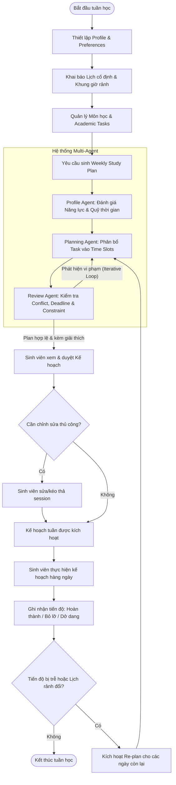

# Phân tích yêu cầu đã được duyệt

## Mục lục

- [Phân tích yêu cầu đã được duyệt](#phân-tích-yêu-cầu-đã-được-duyệt)
  - [Mục lục](#mục-lục)
  - [1. Introduction](#1-introduction)
  - [2. Problem Statement](#2-problem-statement)
    - [2.1 Current Situation](#21-current-situation)
    - [2.2 Problems](#22-problems)
    - [2.3 Project Objectives](#23-project-objectives)
    - [Decision gate: Khả năng truy cập API của UIT](#decision-gate-khả-năng-truy-cập-api-của-uit)
  - [3. Target Users \& Personas](#3-target-users--personas)
    - [Persona P1 – Regular Student (Sinh viên học tập tập trung)](#persona-p1--regular-student-sinh-viên-học-tập-tập-trung)
    - [Persona P2 – Working / Intern Student (Sinh viên vừa học vừa làm/thực tập)](#persona-p2--working--intern-student-sinh-viên-vừa-học-vừa-làmthực-tập)
    - [Persona P3 – Heavy Workload Student (Sinh viên đối mặt nhiều đồ án cao điểm)](#persona-p3--heavy-workload-student-sinh-viên-đối-mặt-nhiều-đồ-án-cao-điểm)
  - [4. User Needs](#4-user-needs)
  - [5. Main User Journey](#5-main-user-journey)
    - [5.1 Mô tả theo quy trình (Textual Flow)](#51-mô-tả-theo-quy-trình-textual-flow)
    - [5.2 Mermaid Flowchart](#52-mermaid-flowchart)
  - [6. Use Cases](#6-use-cases)

## 1. Introduction

Tài liệu này xác định tập yêu cầu phần mềm phiên bản v0.1 cho hệ thống Multi-Agent hỗ trợ sinh viên lập kế hoạch học tập cá nhân hóa. Trong môi trường đào tạo theo học chế tín chỉ tại Trường Đại học Công nghệ Thông tin – ĐHQG-HCM (UIT), sinh viên thường xuyên phải xử lý đồng thời nhiều đồ án môn học, bài tập lab và lịch trình cá nhân/việc làm. Hệ thống được xây dựng nhằm giải quyết bài toán quản trị thời gian tự học theo tuần mang tính thực tế và thích ứng linh hoạt khi có biến động.

Mục đích của tài liệu là thiết lập ranh giới phạm vi (Scope Boundary), phân tích nhu cầu người dùng, xác định các quy tắc nghiệp vụ (Business Rules), yêu cầu chức năng (Functional Requirements) và phi chức năng (Non-Functional Requirements) cho phiên bản khả dụng tối thiểu (MVP). Tài liệu đóng vai trò là kim chỉ nam kỹ thuật giúp 01 developer hiện thực hóa hệ thống trong thời lượng 13 tuần với nguồn lực thời gian bán thời gian (buổi tối).

Hệ thống định vị là công cụ hỗ trợ cá nhân hóa tự học, không thay thế hệ thống quản lý đào tạo và không phải là một hệ thống LMS (Learning Management System).

**Nguồn và trạng thái:** `docs/requirements_analysis_v0.1.md`, mục 1, được duyệt.

## 2. Problem Statement

### 2.1 Current Situation

Sinh viên UIT hiện phải tự điều phối một khối lượng công việc phân tán từ nhiều nguồn:

- Lịch học cố định trên lớp (lý thuyết, thực hành, kiểm tra tập trung).
- Bài tập định kỳ (assignments, lab sheets, weekly quiz).
- Đồ án môn học (course projects) kéo dài nhiều tuần với nhiều mốc nộp bài (milestones).
- Ôn tập kỳ thi giữa kỳ (midterm) và cuối kỳ (final exam).
- Lịch làm thêm hoặc thực tập doanh nghiệp (internship/part-time job) phổ biến ở sinh viên năm 3 và năm 4.
- Hoạt động sinh hoạt cá nhân, gia đình và nghỉ ngơi phục hồi thể lực.

### 2.2 Problems

1. **Mất cân đối định lượng giữa khối lượng công việc và quỹ thời gian thực tế:** Sinh viên ghi nhận danh sách deadline nhưng không định lượng được tổng số giờ cần thiết (estimated effort) so với tổng số giờ thực sự rảnh trong tuần, dẫn đến tình trạng vỡ kế hoạch không lường trước.
2. **Hành vi dồn việc vào sát hạn nộp (Crunch / Procrastination):** Các đồ án môn học lớn thường bị trì hoãn tới 1–2 ngày trước deadline mới bắt đầu thực hiện, gây ra tình trạng thức đêm, giảm sút chất lượng sản phẩm và kiệt sức (burnout).
3. **Xung đột ưu tiên trong các tuần cao điểm:** Khi có từ 3–5 deadline rơi vào cùng một tuần (điển hình là tuần 8 giữa kỳ hoặc tuần 14–16 cuối kỳ), sinh viên lúng túng trong việc quyết định thứ tự thực hiện các task để tối ưu kết quả học tập.
4. **Kế hoạch tĩnh bị gãy đổ khi có biến động thực tế:** Các phương pháp lập lịch thủ công (Google Calendar, Notion, sổ tay) không hỗ trợ cơ chế tái lập kế hoạch linh hoạt. Khi một buổi học bị lỡ hoặc task kéo dài hơn dự kiến, kế hoạch cho các ngày tiếp theo trở nên vô hiệu, khiến sinh viên nản lòng và từ bỏ việc theo dõi.
5. **Kế hoạch xung đột với nhịp sinh học và năng lực tiếp thu:** Lập lịch thiếu tính cá nhân hóa (ví dụ: xếp buổi tự học 4 tiếng liên tục sau 8 tiếng đi làm ban ngày) không khả thi về mặt sinh học, dẫn đến tỷ lệ bỏ dở kế hoạch cao.
6. **Kiệt quệ nhận thức (Decision Fatigue) mỗi ngày:** Sinh viên tiêu tốn thời gian và năng lượng tâm lý mỗi tối chỉ để suy nghĩ: "Hôm nay mình nên bắt đầu từ môn nào, làm trong bao lâu?".

### 2.3 Project Objectives

- **Mục tiêu chính (Primary Objective):** Xây dựng một giải pháp phần mềm MVP ứng dụng Multi-Agent hỗ trợ sinh viên UIT tự động lập và điều chỉnh kế hoạch học tập cá nhân theo chu kỳ tuần, đảm bảo tính khả thi về mặt thời gian, tôn trọng sở thích cá nhân và cung cấp giải thích logic phân bổ.
- **Mục tiêu phụ (Secondary Objectives):**
  1. Cho phép sinh viên quản lý tập trung lịch cố định, danh mục môn học và danh sách task học thuật trong một hệ thống gọn nhẹ.
  2. Tự động kiểm tra tính khả thi và cảnh báo xung đột (quá tải thời gian, trùng lịch bận, vi phạm deadline) trước khi sinh viên phê duyệt kế hoạch.
  3. Cung cấp cơ chế tự động tái lập lịch (Re-plan) thích ứng khi sinh viên ghi nhận tiến độ chậm hơn dự kiến hoặc thời gian rảnh thay đổi.
  4. Rút ngắn thời gian lập kế hoạch tuần của sinh viên xuống dưới 10 phút mỗi tuần.
  5. Cung cấp giải thích ngắn gọn, minh bạch cho từng quyết định phân bổ thời gian học tập của hệ thống.

### Decision gate: Khả năng truy cập API của UIT

- **Giả định tạm thời:** Hệ thống hiện tạm giả định rằng Trường Đại học Công nghệ Thông tin – ĐHQG-HCM (UIT) không cung cấp API để agent tự động lấy thông tin liên quan, chẳng hạn thời khóa biểu hoặc dữ liệu học tập.
- **Trạng thái:** Chưa được xác minh; đây là decision gate cần điều tra thêm, không phải dữ kiện đã xác nhận.
- **Cần làm rõ:** Xác minh với UIT và/hoặc qua tài liệu, đầu mối có thẩm quyền xem có API chính thức, điều kiện truy cập, phạm vi dữ liệu và chính sách sử dụng hay không.
- **Tác động đến quyết định:** Chưa chốt phương án tích hợp hay tự động trích xuất dữ liệu. Phạm vi MVP và cách nhập liệu cần được xem xét lại sau khi decision gate này được giải quyết.

**Nguồn và trạng thái:** `docs/requirements_analysis_v0.1.md`, mục 2, được duyệt. Ghi chú decision gate được bổ sung theo chỉ đạo của người duyệt; chưa phải kết luận về năng lực API thực tế của UIT.

## 3. Target Users & Personas

| ID  | Persona                                                         | Tóm tắt                                                                       | Đối tượng                                           | Trạng thái / nguồn                                                                         |
| --- | --------------------------------------------------------------- | ----------------------------------------------------------------------------- | --------------------------------------------------- | ------------------------------------------------------------------------------------------ |
| P1  | Regular Student (Sinh viên học tập tập trung)                   | Sinh viên học toàn thời gian, cần duy trì nhịp học đều và chia nhỏ đồ án.     | Sinh viên năm 2–3                                   | Được duyệt; `docs/requirements_analysis_v0.1.md`, mục 4. Persona giả định, cần kiểm chứng. |
| P2  | Working / Intern Student (Sinh viên vừa học vừa làm/thực tập)   | Sinh viên có ít thời gian tự học, cần tôn trọng lịch làm và cảnh báo quá tải. | Sinh viên năm 3–4 vừa học vừa làm/thực tập          | Được duyệt; `docs/requirements_analysis_v0.1.md`, mục 4. Persona giả định, cần kiểm chứng. |
| P3  | Heavy Workload Student (Sinh viên đối mặt nhiều đồ án cao điểm) | Sinh viên có nhiều đồ án, deadline tập trung và nhu cầu tái lập kế hoạch.     | Sinh viên trong học kỳ chuyên ngành có workload cao | Được duyệt; `docs/requirements_analysis_v0.1.md`, mục 4. Persona giả định, cần kiểm chứng. |

### Persona P1 – Regular Student (Sinh viên học tập tập trung)

- **Context:** Sinh viên năm 2 hoặc năm 3, học toàn thời gian tại cơ sở UIT (Thủ Đức). Đăng ký từ 18–21 tín chỉ, không đi làm thêm ngoài giờ. Tham gia đều đặn các buổi học lý thuyết và thực hành trên giảng đường.
- **Pain Points:**
  - Dễ chủ quan vì thấy quỹ thời gian buổi tối và cuối tuần còn nhiều.
  - Trì hoãn các bài tập lớn/đồ án môn học đến sát deadline.
  - Mất tập trung vào mạng xã hội buổi tối do không có mục tiêu cụ thể cho từng khung giờ.
- **Goals:** Tạo lập thói quen học tập đều đặn mỗi ngày; hoàn thành đồ án từng bước để đạt điểm cao; không bị thức đêm trong tuần thi cử.
- **Typical Availability:**
  - Thứ 2 – Thứ 6: 19:00 – 23:00 (khoảng 3–4 tiếng/tối).
  - Thứ 7 – Chủ Nhật: 08:30 – 11:30 và 14:00 – 17:30 (khoảng 6–7 tiếng/ngày).
- **Expectation from System:** Hệ thống đưa ra checklist rõ ràng từng tối: học môn gì, làm task nào, thời lượng bao nhiêu phút; tự động chia nhỏ các đồ án dài hạn.

### Persona P2 – Working / Intern Student (Sinh viên vừa học vừa làm/thực tập)

- **Context:** Sinh viên năm 3 hoặc năm 4, đăng ký từ 12–15 tín chỉ tại UIT kết hợp thực tập hoặc làm việc bán thời gian tại doanh nghiệp công nghệ (khoảng 35-40 giờ/tuần).
- **Pain Points:**
  - Quỹ thời gian học tự do cực kỳ hạn chế và manh mún.
  - Sau ngày làm việc tại công ty thường mệt mỏi, khó tiếp thu bài vở nếu bị xếp lịch học quá dài hoặc quá muộn.
  - Dễ bỏ sót các deadline bài tập nhỏ trên lớp do tập trung vào công việc tại công ty.
- **Goals:** Tối ưu hóa từng giờ tự học ít ỏi; đảm bảo nộp bài đúng hạn và qua môn tốt mà không ảnh hưởng tới chất lượng công việc doanh nghiệp.
- **Typical Availability:**
  - Thứ 2 – Thứ 6: 20:30 – 23:00 (khoảng 1.5–2 tiếng/tối sau khi đi làm về và ăn uống).
  - Thứ 7: 13:30 – 17:30 (4 tiếng).
  - Chủ Nhật: Dành nghỉ ngơi hoặc chỉ học tối đa 2–3 tiếng.
- **Expectation from System:** Hệ thống tôn trọng tuyệt đối các slot bận (lịch làm việc, thời gian di chuyển, nghỉ ngơi); ưu tiên các task cận hạn; cảnh báo ngay khi khối lượng bài tập vượt quá tổng số giờ rảnh còn lại trong tuần.

### Persona P3 – Heavy Workload Student (Sinh viên đối mặt nhiều đồ án cao điểm)

- **Context:** Sinh viên đang trong học kỳ chuyên ngành nặng (ví dụ: Chuyên ngành Kỹ thuật phần mềm, Hệ thống thông tin...), gánh đồng thời 3–4 môn có đồ án lớn (project-based), phải phối hợp làm việc nhóm với các bạn cùng lớp.
- **Pain Points:**
  - Xung đột deadline tập trung vào các tuần 8–10 (báo cáo giữa kỳ) và tuần 14–16 (bảo vệ cuối kỳ).
  - Khi một đồ án phát sinh sự cố mất thêm thời gian (debug, họp nhóm đột xuất), toàn bộ kế hoạch tự học của các môn còn lại bị đổ vỡ dây chuyền.
  - Khó khăn trong việc cân bằng nỗ lực giữa môn điểm số quan trọng và môn phụ.
- **Goals:** Tránh bị trễ hạn các mốc nộp đồ án; kiểm soát được tiến độ công việc hàng ngày; tái lập lịch tức thì khi bị trễ kế hoạch.
- **Typical Availability:**
  - Lịch học trên lớp và lịch họp nhóm biến động linh hoạt theo tuần.
  - Sẵn sàng học dồn 5–6 tiếng vào các ngày không có lịch thực hành.
- **Expectation from System:** Hỗ trợ tính năng Re-plan nhanh chóng khi không hoàn thành phiên học; tự động điều phối thứ tự ưu tiên dựa trên mức độ quan trọng và deadline của từng đồ án.

**Nguồn và trạng thái:** `docs/requirements_analysis_v0.1.md`, mục 4, được duyệt. Các persona là mô hình đại diện giả định; các đặc điểm và availability cần được kiểm chứng với sinh viên UIT.

## 4. User Needs

| ID | Nhu cầu | Tóm tắt | Đối tượng | Trạng thái / nguồn |
|---|---|---|---|---|
| UN-01 | Lập kế hoạch theo thời gian rảnh | Biết task cần tập trung trong từng ngày/buổi dựa trên thời gian rảnh thực tế. | Sinh viên | Được duyệt; `docs/requirements_analysis_v0.1.md`, mục 5. |
| UN-02 | Tránh xung đột lịch | Kế hoạch không trùng lịch học, làm việc/thực tập và thời gian cá nhân đã khai báo. | Sinh viên | Được duyệt; `docs/requirements_analysis_v0.1.md`, mục 5. |
| UN-03 | Cảnh báo quá tải | Được cảnh báo khi tổng effort ước lượng vượt thời gian rảnh trong tuần. | Sinh viên | Được duyệt; `docs/requirements_analysis_v0.1.md`, mục 5. |
| UN-04 | Chia nhỏ task lớn | Chia đồ án/bài tập lớn thành nhiều study session trước deadline. | Sinh viên | Được duyệt; `docs/requirements_analysis_v0.1.md`, mục 5. |
| UN-05 | Tuân thủ sở thích và giới hạn | Kế hoạch tôn trọng sở thích và giới hạn cá nhân về thời lượng, số giờ và khung giờ học. | Sinh viên | Được duyệt; `docs/requirements_analysis_v0.1.md`, mục 5. |
| UN-06 | Giải thích phân bổ | Biết lý do ngắn gọn hệ thống xếp task vào một khung giờ cụ thể. | Sinh viên | Được duyệt; `docs/requirements_analysis_v0.1.md`, mục 5. |
| UN-07 | Chỉnh sửa kế hoạch | Có thể di chuyển, đổi lịch hoặc xóa study session do hệ thống tạo. | Sinh viên | Được duyệt; `docs/requirements_analysis_v0.1.md`, mục 5. |
| UN-08 | Ghi nhận tiến độ | Ghi nhận trạng thái hoàn thành hoặc thời gian thực tế đã học cho từng session. | Sinh viên | Được duyệt; `docs/requirements_analysis_v0.1.md`, mục 5. |
| UN-09 | Tái lập kế hoạch | Lập lại kế hoạch cho thời gian còn lại khi lỡ session hoặc thời gian rảnh thay đổi. | Sinh viên | Được duyệt; `docs/requirements_analysis_v0.1.md`, mục 5. |
| UN-10 | Quản lý dữ liệu học tập | Quản lý tập trung môn học, task học thuật và deadline tương ứng. | Sinh viên | Được duyệt; `docs/requirements_analysis_v0.1.md`, mục 5. |
| UN-11 | Đánh dấu mức độ quan trọng của task | Gán hệ số mức độ quan trọng từ 1 đến 5, cho phép giá trị theo bước 0,1. | Sinh viên | Được duyệt theo chỉ đạo người dùng bổ sung vào mục 5. |
| UN-12 | Ước lượng thời gian hoàn thành task | Nhập thời gian hoàn thành ước lượng theo giờ hoặc yêu cầu hệ thống đưa ra ước lượng theo giờ. | Sinh viên | Được duyệt theo chỉ đạo người dùng bổ sung vào mục 5. |

### UN-01 – Lập kế hoạch theo thời gian rảnh

Sinh viên cần biết cụ thể trong mỗi ngày/buổi học mình nên tập trung làm task nào dựa trên quỹ thời gian rảnh thực tế.

### UN-02 – Tránh xung đột lịch

Sinh viên cần kế hoạch học tập không bị trùng lặp (conflict) với lịch học trên trường, lịch làm việc/thực tập và các khung thời gian cá nhân đã xác định.

### UN-03 – Cảnh báo quá tải

Sinh viên cần hệ thống tự động cảnh báo sớm khi tổng số giờ ước lượng của các task vượt quá tổng thời gian rảnh trong tuần (quá tải lịch trình).

### UN-04 – Chia nhỏ task lớn

Sinh viên cần các đồ án/bài tập lớn được hệ thống hỗ trợ chia thành nhiều phiên học (study sessions) rải đều trong tuần trước deadline thay vì dồn vào ngày nộp.

### UN-05 – Tuân thủ sở thích và giới hạn

Sinh viên cần kế hoạch học tập tuân thủ theo các sở thích và giới hạn cá nhân (ví dụ: thời lượng tối đa mỗi phiên học, số giờ học tối đa trong ngày, thời điểm học ưa thích).

### UN-06 – Giải thích phân bổ

Sinh viên cần biết lý do ngắn gọn vì sao hệ thống lại sắp xếp một task vào một khung giờ cụ thể để cảm thấy tin tưởng và có động lực thực hiện.

### UN-07 – Chỉnh sửa kế hoạch

Sinh viên cần có quyền can thiệp, chỉnh sửa thủ công (di chuyển, đổi lịch, xóa) các phiên học do hệ thống sinh ra khi cảm thấy chưa phù hợp với hoàn cảnh thực tế.

### UN-08 – Ghi nhận tiến độ

Sinh viên cần ghi nhận trạng thái hoàn thành hoặc số giờ thực tế đã học của từng phiên học một cách đơn giản, nhanh chóng.

### UN-09 – Tái lập kế hoạch

Sinh viên cần hệ thống tự động tái lập kế hoạch (re-plan) cho những ngày còn lại trong tuần khi một phiên học bị bỏ lỡ hoặc khi quỹ thời gian rảnh thay đổi đột xuất.

### UN-10 – Quản lý dữ liệu học tập

Sinh viên cần lưu trữ và quản lý tập trung danh mục môn học, các loại task học thuật (bài tập, đồ án, ôn thi) và hạn nộp tương ứng tại một giao diện trực quan.

### UN-11 – Đánh dấu mức độ quan trọng của task

Sinh viên cần có thể gán cho task một hệ số mức độ quan trọng từ 1 đến 5, với độ chính xác đến một chữ số thập phân (bước 0,1).

### UN-12 – Ước lượng thời gian hoàn thành task

Sinh viên cần có thể tự nhập thời gian hoàn thành task ước lượng theo giờ hoặc yêu cầu hệ thống ước lượng thời gian đó theo giờ.

**Nguồn và trạng thái:** UN-01–UN-10 được duyệt từ `docs/requirements_analysis_v0.1.md`, mục 5. UN-11–UN-12 được duyệt theo chỉ đạo người dùng trong lần duyệt này; cách hệ thống ước lượng thời gian và cơ sở ước lượng vẫn cần được đặc tả, chưa được xác định ở đây.

## 5. Main User Journey

### 5.1 Mô tả theo quy trình (Textual Flow)

1. **Initial Setup & Profile:** Sinh viên thiết lập hồ sơ cá nhân cơ bản và cấu hình sở thích học tập (thời lượng mong muốn cho một phiên học, số giờ học tối đa mỗi ngày, khung thời gian học ưa thích).
2. **Fixed Schedule & Availability:** Sinh viên khai báo lịch cố định hàng tuần (lịch học trên trường, lịch đi làm/thực tập) và đánh dấu các khung giờ bận cá nhân. Hệ thống tính toán ra các khoảng thời gian rảnh khả dụng (Available Study Slots).
3. **Courses & Tasks Definition:** Sinh viên tạo danh sách môn học trong kỳ và nhập danh sách task học thuật cần xử lý (tên task, môn học, deadline, estimated effort, mức độ ưu tiên).
4. **Plan Generation Request:** Sinh viên kích hoạt yêu cầu tạo kế hoạch học tập cho tuần mục tiêu.
5. **System Generation & Review Loop:** Planning Agent dự thảo phân bổ các task vào các slot rảnh; Review Agent kiểm tra tính hợp lệ (trùng lịch, vi phạm deadline, quá tải, tuân thủ preference). Nếu có lỗi, Planning Agent tinh chỉnh lại trước khi trả về kết quả.
6. **Student Review & Confirmation:** Sinh viên xem bản kế hoạch tuần được đề xuất kèm giải thích lý do phân bổ. Sinh viên có thể chấp thuận hoặc điều chỉnh thủ công các phiên học.
7. **Execution & Daily Progress Tracking:** Trong tuần, sinh viên mở kế hoạch theo ngày, bấm bắt đầu/hoàn thành hoặc cập nhật tiến độ thực tế (ví dụ: task hoàn thành 50%, hoặc phiên học bị bỏ lỡ).
8. **Dynamic Re-planning:** Khi xảy ra sai lệch tiến độ hoặc lịch bận thay đổi, sinh viên kích hoạt tính năng Re-plan. Hệ thống đánh giá lại khối lượng công việc còn lại và phân bổ lại lịch cho các ngày còn lại trong tuần.

### 5.2 Mermaid Flowchart

**Nguồn và trạng thái:** `docs/requirements_analysis_v0.1.md`, mục 6, được duyệt.

## 6. Use Cases

| ID | Use Case | Actor | Tóm tắt |
|---|---|---|---|
| [UC-01](use-case/use-cases.md#uc-01-manage-student-profile) | Manage Student Profile | Sinh viên | Tạo, xem và cập nhật hồ sơ học tập cùng sở thích học tập. |
| [UC-02](use-case/use-cases.md#uc-02-manage-availability) | Manage Availability | Sinh viên | Khai báo, chỉnh sửa và xóa thời gian bận để xác định slot rảnh. |
| [UC-03](use-case/use-cases.md#uc-03-manage-courses) | Manage Courses | Sinh viên | Quản lý danh mục môn học trong học kỳ. |
| [UC-04](use-case/use-cases.md#uc-04-manage-academic-tasks) | Manage Academic Tasks | Sinh viên | Tạo, xem, sửa và hủy task học thuật. |
| [UC-05](use-case/use-cases.md#uc-05-generate-weekly-study-plan) | Generate Weekly Study Plan | Sinh viên | Yêu cầu hệ thống sinh kế hoạch học tập theo tuần. |
| [UC-06](use-case/use-cases.md#uc-06-review-generated-plan) | Review Generated Plan | Sinh viên | Xem xét, điều chỉnh hoặc xác nhận kế hoạch được đề xuất. |
| [UC-07](use-case/use-cases.md#uc-07-modify-study-plan) | Modify Study Plan | Sinh viên | Điều chỉnh các phiên học trong kế hoạch tuần. |
| [UC-08](use-case/use-cases.md#uc-08-record-progress) | Record Progress | Sinh viên | Ghi nhận kết quả thực tế sau mỗi phiên học. |
| [UC-09](use-case/use-cases.md#uc-09-re-plan-study-schedule) | Re-plan Study Schedule | Sinh viên | Tính và phân bổ lại các phiên học chưa hoàn thành. |
| [UC-10](use-case/use-cases.md#uc-10-explain-planning-decision) | Explain Planning Decision | Sinh viên | Xem giải thích cho quyết định phân bổ hoặc ưu tiên task. |

**Nguồn và trạng thái:** `docs/requirements_analysis_v0.1.md`, mục 7, được duyệt. Theo chỉ đạo, tài liệu chung chỉ liệt kê danh sách UC; đặc tả chi tiết từng UC không được sao chép vào đây.
