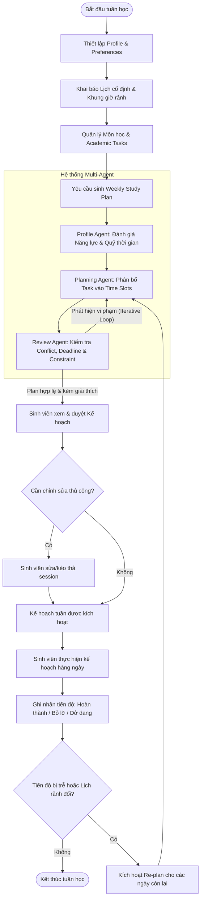

# Bản Thảo Phân Tích Yêu Cầu Phần Mềm (Software Requirements Analysis v0.1)

**Đề tài:** Xây dựng hệ thống Multi-Agent hỗ trợ sinh viên lập kế hoạch học tập cá nhân hóa  
**Phiên bản:** v0.1 (Draft)  
**Ngày lập:** 15/09/2026  
**Người thực hiện:** Business Analyst & Software Requirements Analyst  
**Bối cảnh dự án:** Dự án cá nhân (1 Developer), thời gian 13 tuần, triển khai ngoài giờ (buổi tối), môi trường mục tiêu là sinh viên Trường Đại học Công nghệ Thông tin – ĐHQG-HCM (UIT).

---

## 1. Introduction

Tài liệu này xác định tập yêu cầu phần mềm phiên bản v0.1 cho hệ thống Multi-Agent hỗ trợ sinh viên lập kế hoạch học tập cá nhân hóa. Trong môi trường đào tạo theo học chế tín chỉ tại Trường Đại học Công nghệ Thông tin – ĐHQG-HCM (UIT), sinh viên thường xuyên phải xử lý đồng thời nhiều đồ án môn học, bài tập lab và lịch trình cá nhân/việc làm. Hệ thống được xây dựng nhằm giải quyết bài toán quản trị thời gian tự học theo tuần mang tính thực tế và thích ứng linh hoạt khi có biến động.

Mục đích của tài liệu là thiết lập ranh giới phạm vi (Scope Boundary), phân tích nhu cầu người dùng, xác định các quy tắc nghiệp vụ (Business Rules), yêu cầu chức năng (Functional Requirements) và phi chức năng (Non-Functional Requirements) cho phiên bản khả dụng tối thiểu (MVP). Tài liệu đóng vai trò là kim chỉ nam kỹ thuật giúp 01 developer hiện thực hóa hệ thống trong thời lượng 13 tuần với nguồn lực thời gian bán thời gian (buổi tối).

Hệ thống định vị là công cụ hỗ trợ cá nhân hóa tự học, không thay thế hệ thống quản lý đào tạo và không phải là một hệ thống LMS (Learning Management System).

---

## 2. Problem Statement

### 2.1 Current Situation
Sinh viên UIT hiện phải tự điều phối một khối lượng công việc phân tán từ nhiều nguồn:
* Lịch học cố định trên lớp (lý thuyết, thực hành, kiểm tra tập trung).
* Bài tập định kỳ (assignments, lab sheets, weekly quiz).
* Đồ án môn học (course projects) kéo dài nhiều tuần với nhiều mốc nộp bài (milestones).
* Ôn tập kỳ thi giữa kỳ (midterm) và cuối kỳ (final exam).
* Lịch làm thêm hoặc thực tập doanh nghiệp (internship/part-time job) phổ biến ở sinh viên năm 3 và năm 4.
* Hoạt động sinh hoạt cá nhân, gia đình và nghỉ ngơi phục hồi thể lực.

### 2.2 Problems
1. **Mất cân đối định lượng giữa khối lượng công việc và quỹ thời gian thực tế:** Sinh viên ghi nhận danh sách deadline nhưng không định lượng được tổng số giờ cần thiết (estimated effort) so với tổng số giờ thực sự rảnh trong tuần, dẫn đến tình trạng vỡ kế hoạch không lường trước.
2. **Hành vi dồn việc vào sát hạn nộp (Crunch / Procrastination):** Các đồ án môn học lớn thường bị trì hoãn tới 1–2 ngày trước deadline mới bắt đầu thực hiện, gây ra tình trạng thức đêm, giảm sút chất lượng sản phẩm và kiệt sức (burnout).
3. **Xung đột ưu tiên trong các tuần cao điểm:** Khi có từ 3–5 deadline rơi vào cùng một tuần (điển hình là tuần 8 giữa kỳ hoặc tuần 14–16 cuối kỳ), sinh viên lúng túng trong việc quyết định thứ tự thực hiện các task để tối ưu kết quả học tập.
4. **Kế hoạch tĩnh bị gãy đổ khi có biến động thực tế:** Các phương pháp lập lịch thủ công (Google Calendar, Notion, sổ tay) không hỗ trợ cơ chế tái lập kế hoạch linh hoạt. Khi một buổi học bị lỡ hoặc task kéo dài hơn dự kiến, kế hoạch cho các ngày tiếp theo trở nên vô hiệu, khiến sinh viên nản lòng và từ bỏ việc theo dõi.
5. **Kế hoạch xung đột với nhịp sinh học và năng lực tiếp thu:** Lập lịch thiếu tính cá nhân hóa (ví dụ: xếp buổi tự học 4 tiếng liên tục sau 8 tiếng đi làm ban ngày) không khả thi về mặt sinh học, dẫn đến tỷ lệ bỏ dở kế hoạch cao.
6. **Kiệt quệ nhận thức (Decision Fatigue) mỗi ngày:** Sinh viên tiêu tốn thời gian và năng lượng tâm lý mỗi tối chỉ để suy nghĩ: "Hôm nay mình nên bắt đầu từ môn nào, làm trong bao lâu?".

### 2.3 Project Objectives
* **Mục tiêu chính (Primary Objective):** Xây dựng một giải pháp phần mềm MVP ứng dụng Multi-Agent hỗ trợ sinh viên UIT tự động lập và điều chỉnh kế hoạch học tập cá nhân theo chu kỳ tuần, đảm bảo tính khả thi về mặt thời gian, tôn trọng sở thích cá nhân và cung cấp giải thích logic phân bổ.
* **Mục tiêu phụ (Secondary Objectives):**
  1. Cho phép sinh viên quản lý tập trung lịch cố định, danh mục môn học và danh sách task học thuật trong một hệ thống gọn nhẹ.
  2. Tự động kiểm tra tính khả thi và cảnh báo xung đột (quá tải thời gian, trùng lịch bận, vi phạm deadline) trước khi sinh viên phê duyệt kế hoạch.
  3. Cung cấp cơ chế tự động tái lập lịch (Re-plan) thích ứng khi sinh viên ghi nhận tiến độ chậm hơn dự kiến hoặc thời gian rảnh thay đổi.
  4. Rút ngắn thời gian lập kế hoạch tuần của sinh viên xuống dưới 10 phút mỗi tuần.
  5. Cung cấp giải thích ngắn gọn, minh bạch cho từng quyết định phân bổ thời gian học tập của hệ thống.

---

## 3. Stakeholders

| Stakeholder                                                           | Role                                                                                     | Need / Concern                                                                                                                                                                                      |
| :-------------------------------------------------------------------- | :--------------------------------------------------------------------------------------- | :-------------------------------------------------------------------------------------------------------------------------------------------------------------------------------------------------- |
| **Sinh viên UIT (Primary Stakeholder)**                               | Người sử dụng trực tiếp hệ thống hàng ngày để lập và theo dõi kế hoạch học tập.          | Cần một công cụ dễ dùng, không tốn thời gian nhập liệu phức tạp; kế hoạch sinh ra phải thực tế, không xung đột với lịch học/làm và có thể điều chỉnh nhanh khi bị trễ hạn.                          |
| **Project Developer (Secondary Stakeholder)**                         | Kỹ sư phần mềm duy nhất thiết kế, hiện thực hóa, kiểm thử và vận hành hệ thống.          | Cần giới hạn phạm vi MVP rõ ràng để hoàn thành trong 13 tuần (làm buổi tối); kiến trúc đơn giản, tránh over-engineering; chi phí tài nguyên/API AI ở mức chấp nhận được.                            |
| **Giảng viên hướng dẫn / Hội đồng phản biện (Secondary Stakeholder)** | Đánh giá học thuật, tính ứng dụng thực tiễn và phương pháp kỹ thuật phần mềm của đề tài. | Quan tâm đến tính đúng đắn của quy trình phân tích yêu cầu; việc ứng dụng Multi-Agent có đem lại giá trị thực sự so với single-prompt hay không; giải pháp có khả thi và kiểm chứng được hay không. |

---

## 4. Target Users & Personas

### Persona P1 – Regular Student (Sinh viên học tập tập trung)
* **Context:** Sinh viên năm 2 hoặc năm 3, học toàn thời gian tại cơ sở UIT (Thủ Đức). Đăng ký từ 18–21 tín chỉ, không đi làm thêm ngoài giờ. Tham gia đều đặn các buổi học lý thuyết và thực hành trên giảng đường.
* **Pain Points:** 
  * Dễ chủ quan vì thấy quỹ thời gian buổi tối và cuối tuần còn nhiều.
  * Trì hoãn các bài tập lớn/đồ án môn học đến sát deadline.
  * Mất tập trung vào mạng xã hội buổi tối do không có mục tiêu cụ thể cho từng khung giờ.
* **Goals:** Tạo lập thói quen học tập đều đặn mỗi ngày; hoàn thành đồ án từng bước để đạt điểm cao; không bị thức đêm trong tuần thi cử.
* **Typical Availability:** 
  * Thứ 2 – Thứ 6: 19:00 – 23:00 (khoảng 3–4 tiếng/tối).
  * Thứ 7 – Chủ Nhật: 08:30 – 11:30 và 14:00 – 17:30 (khoảng 6–7 tiếng/ngày).
* **Expectation from System:** Hệ thống đưa ra checklist rõ ràng từng tối: học môn gì, làm task nào, thời lượng bao nhiêu phút; tự động chia nhỏ các đồ án dài hạn.

### Persona P2 – Working / Intern Student (Sinh viên vừa học vừa làm/thực tập)
* **Context:** Sinh viên năm 3 hoặc năm 4, đăng ký từ 12–15 tín chỉ tại UIT kết hợp thực tập hoặc làm việc bán thời gian tại doanh nghiệp công nghệ (khoảng 20–30 giờ/tuần).
* **Pain Points:**
  * Quỹ thời gian học tự do cực kỳ hạn chế và manh mún.
  * Sau ngày làm việc tại công ty thường mệt mỏi, khó tiếp thu bài vở nếu bị xếp lịch học quá dài hoặc quá muộn.
  * Dễ bỏ sót các deadline bài tập nhỏ trên lớp do tập trung vào công việc tại công ty.
* **Goals:** Tối ưu hóa từng giờ tự học ít ỏi; đảm bảo nộp bài đúng hạn và qua môn tốt mà không ảnh hưởng tới chất lượng công việc doanh nghiệp.
* **Typical Availability:**
  * Thứ 2 – Thứ 6: 20:30 – 23:00 (khoảng 1.5–2 tiếng/tối sau khi đi làm về và ăn uống).
  * Thứ 7: 13:30 – 17:30 (4 tiếng).
  * Chủ Nhật: Dành nghỉ ngơi hoặc chỉ học tối đa 2–3 tiếng.
* **Expectation from System:** Hệ thống tôn trọng tuyệt đối các slot bận (lịch làm việc, thời gian di chuyển, nghỉ ngơi); ưu tiên các task cận hạn; cảnh báo ngay khi khối lượng bài tập vượt quá tổng số giờ rảnh còn lại trong tuần.

### Persona P3 – Heavy Workload Student (Sinh viên đối mặt nhiều đồ án cao điểm)
* **Context:** Sinh viên đang trong học kỳ chuyên ngành nặng (ví dụ: Chuyên ngành Kỹ thuật phần mềm, Hệ thống thông tin...), gánh đồng thời 3–4 môn có đồ án lớn (project-based), phải phối hợp làm việc nhóm với các bạn cùng lớp.
* **Pain Points:**
  * Xung đột deadline tập trung vào các tuần 8–10 (báo cáo giữa kỳ) và tuần 14–16 (bảo vệ cuối kỳ).
  * Khi một đồ án phát sinh sự cố mất thêm thời gian (debug, họp nhóm đột xuất), toàn bộ kế hoạch tự học của các môn còn lại bị đổ vỡ dây chuyền.
  * Khó khăn trong việc cân bằng nỗ lực giữa môn điểm số quan trọng và môn phụ.
* **Goals:** Tránh bị trễ hạn các mốc nộp đồ án; kiểm soát được tiến độ công việc hàng ngày; tái lập lịch tức thì khi bị trễ kế hoạch.
* **Typical Availability:**
  * Lịch học trên lớp và lịch họp nhóm biến động linh hoạt theo tuần.
  * Sẵn sàng học dồn 5–6 tiếng vào các ngày không có lịch thực hành.
* **Expectation from System:** Hỗ trợ tính năng Re-plan nhanh chóng khi không hoàn thành phiên học; tự động điều phối thứ tự ưu tiên dựa trên mức độ quan trọng và deadline của từng đồ án.

---

## 5. User Needs

* **UN-01:** Sinh viên cần biết cụ thể trong mỗi ngày/buổi học mình nên tập trung làm task nào dựa trên quỹ thời gian rảnh thực tế.
* **UN-02:** Sinh viên cần kế hoạch học tập không bị trùng lặp (conflict) với lịch học trên trường, lịch làm việc/thực tập và các khung thời gian cá nhân đã xác định.
* **UN-03:** Sinh viên cần hệ thống tự động cảnh báo sớm khi tổng số giờ ước lượng của các task vượt quá tổng thời gian rảnh trong tuần (quá tải lịch trình).
* **UN-04:** Sinh viên cần các đồ án/bài tập lớn được hệ thống hỗ trợ chia thành nhiều phiên học (study sessions) rải đều trong tuần trước deadline thay vì dồn vào ngày nộp.
* **UN-05:** Sinh viên cần kế hoạch học tập tuân thủ theo các sở thích và giới hạn cá nhân (ví dụ: thời lượng tối đa mỗi phiên học, số giờ học tối đa trong ngày, thời điểm học ưa thích).
* **UN-06:** Sinh viên cần biết lý do ngắn gọn vì sao hệ thống lại sắp xếp một task vào một khung giờ cụ thể để cảm thấy tin tưởng và có động lực thực hiện.
* **UN-07:** Sinh viên cần có quyền can thiệp, chỉnh sửa thủ công (di chuyển, đổi lịch, xóa) các phiên học do hệ thống sinh ra khi cảm thấy chưa phù hợp với hoàn cảnh thực tế.
* **UN-08:** Sinh viên cần ghi nhận trạng thái hoàn thành hoặc số giờ thực tế đã học của từng phiên học một cách đơn giản, nhanh chóng.
* **UN-09:** Sinh viên cần hệ thống tự động tái lập kế hoạch (re-plan) cho những ngày còn lại trong tuần khi một phiên học bị bỏ lỡ hoặc khi quỹ thời gian rảnh thay đổi đột xuất.
* **UN-10:** Sinh viên cần lưu trữ và quản lý tập trung danh mục môn học, các loại task học thuật (bài tập, đồ án, ôn thi) và hạn nộp tương ứng tại một giao diện trực quan.

---

## 6. Main User Journey

### 6.1 Mô tả theo quy trình (Textual Flow)
1. **Initial Setup & Profile:** Sinh viên thiết lập hồ sơ cá nhân cơ bản và cấu hình sở thích học tập (thời lượng mong muốn cho một phiên học, số giờ học tối đa mỗi ngày, khung thời gian học ưa thích).
2. **Fixed Schedule & Availability:** Sinh viên khai báo lịch cố định hàng tuần (lịch học trên trường, lịch đi làm/thực tập) và đánh dấu các khung giờ bận cá nhân. Hệ thống tính toán ra các khoảng thời gian rảnh khả dụng (Available Study Slots).
3. **Courses & Tasks Definition:** Sinh viên tạo danh sách môn học trong kỳ và nhập danh sách task học thuật cần xử lý (tên task, môn học, deadline, estimated effort, mức độ ưu tiên).
4. **Plan Generation Request:** Sinh viên kích hoạt yêu cầu tạo kế hoạch học tập cho tuần mục tiêu.
5. **System Generation & Review Loop:** Planning Agent dự thảo phân bổ các task vào các slot rảnh; Review Agent kiểm tra tính hợp lệ (trùng lịch, vi phạm deadline, quá tải, tuân thủ preference). Nếu có lỗi, Planning Agent tinh chỉnh lại trước khi trả về kết quả.
6. **Student Review & Confirmation:** Sinh viên xem bản kế hoạch tuần được đề xuất kèm giải thích lý do phân bổ. Sinh viên có thể chấp thuận hoặc điều chỉnh thủ công các phiên học.
7. **Execution & Daily Progress Tracking:** Trong tuần, sinh viên mở kế hoạch theo ngày, bấm bắt đầu/hoàn thành hoặc cập nhật tiến độ thực tế (ví dụ: task hoàn thành 50%, hoặc phiên học bị bỏ lỡ).
8. **Dynamic Re-planning:** Khi xảy ra sai lệch tiến độ hoặc lịch bận thay đổi, sinh viên kích hoạt tính năng Re-plan. Hệ thống đánh giá lại khối lượng công việc còn lại và phân bổ lại lịch cho các ngày còn lại trong tuần.

### 6.2 Mermaid Flowchart

---

## 7. Use Cases

### UC-01: Manage Student Profile
* **ID:** UC-01
* **Name:** Manage Student Profile
* **Actor:** Sinh viên
* **Description:** Cho phép sinh viên tạo mới, xem và cập nhật thông tin hồ sơ học tập cá nhân cùng các thông số sở thích học tập.
* **Preconditions:** Sinh viên đã mở ứng dụng.
* **Trigger:** Sinh viên chọn màn hình quản lý hồ sơ hoặc lần đầu khởi tạo hệ thống.
* **Main Flow:**
  1. Sinh viên mở giao diện quản lý hồ sơ cá nhân.
  2. Hệ thống hiển thị các thông tin hiện tại: Tên sinh viên, MSSV (tùy chọn), danh sách sở thích học tập (thời lượng phiên học mặc định, số giờ học tối đa/ngày, thời điểm học ưa thích: sáng/chiều/tối).
  3. Sinh viên chỉnh sửa các giá trị sở thích.
  4. Sinh viên chọn "Lưu hồ sơ".
  5. Hệ thống xác thực tính hợp lệ của dữ liệu (ví dụ: thời lượng phiên học phải > 0) và lưu lại.
  6. Hệ thống thông báo cập nhật hồ sơ thành công.
* **Alternative Flow:** 
  * *4a. Dữ liệu nhập không hợp lệ:* Hệ thống hiển thị thông báo lỗi cụ thể (ví dụ: số giờ học tối đa trong ngày không được vượt quá 16 giờ) và yêu cầu nhập lại.
* **Postconditions:** Thông tin hồ sơ và sở thích học tập mới được lưu lại để phục vụ cho các thuật toán lập lịch.

---

### UC-02: Manage Availability
* **ID:** UC-02
* **Name:** Manage Availability
* **Actor:** Sinh viên
* **Description:** Cho phép sinh viên khai báo, chỉnh sửa và xóa các khoảng thời gian bận cố định (lịch học trên trường, lịch làm việc, lịch cá nhân) để xác định các slot thời gian rảnh trong tuần.
* **Preconditions:** Sinh viên đã có hồ sơ học tập trong hệ thống.
* **Trigger:** Sinh viên truy cập màn hình quản lý lịch bận / availability.
* **Main Flow:**
  1. Sinh viên xem lưới thời gian (time-grid) theo tuần của mình.
  2. Sinh viên chọn tạo một khung thời gian bận (Fixed Time Block).
  3. Sinh viên nhập: Tên hoạt động (ví dụ: Học môn Mạng máy tính, Đi làm ca sáng), Ngày trong tuần, Giờ bắt đầu, Giờ kết thúc, Tính lặp lại theo tuần (Có/Không).
  4. Sinh viên nhấn "Lưu khung giờ".
  5. Hệ thống kiểm tra tính hợp lệ về thời gian (Giờ kết thúc > Giờ bắt đầu).
  6. Hệ thống cập nhật lưới thời gian và tự động suy diễn các khoảng thời gian rảnh (Available Slots).
* **Alternative Flow:**
  * *5a. Trùng lặp khung giờ cố định:* Hệ thống hiển thị cảnh báo trùng với một khung giờ cố định đã có và yêu cầu người dùng xác nhận ghi đè hoặc chỉnh sửa lại.
* **Postconditions:** Lịch rảnh tuần của sinh viên được cập nhật chính xác làm đầu vào cho quá trình lập lịch.

---

### UC-03: Manage Courses
* **ID:** UC-03
* **Name:** Manage Courses
* **Actor:** Sinh viên
* **Description:** Cho phép sinh viên quản lý danh mục các môn học đang theo học trong học kỳ.
* **Preconditions:** Sinh viên đã truy cập ứng dụng.
* **Trigger:** Sinh viên chọn chức năng quản lý môn học.
* **Main Flow:**
  1. Hệ thống hiển thị danh sách các môn học hiện có kèm mã môn và màu đại diện (nếu có).
  2. Sinh viên chọn "Thêm môn học mới".
  3. Sinh viên nhập: Tên môn học, Mã môn (ví dụ: IT001 - Tùy chọn), Tên giảng viên (Tùy chọn), Mức độ ưu tiên/trọng số môn học (Mặc định: Bình thường).
  4. Sinh viên nhấn "Lưu".
  5. Hệ thống lưu môn học và cập nhật danh sách hiển thị.
* **Alternative Flow:**
  * *Sinh viên chọn Sửa hoặc Xóa:* Hệ thống cho phép cập nhật thông tin môn học. Nếu môn học đã có task liên kết, hệ thống yêu cầu xác nhận trước khi xóa.
* **Postconditions:** Môn học mới được ghi nhận để liên kết với các bài tập và đồ án học thuật.

---

### UC-04: Manage Academic Tasks
* **ID:** UC-04
* **Name:** Manage Academic Tasks
* **Actor:** Sinh viên
* **Description:** Cho phép sinh viên tạo mới, chỉnh sửa, xem chi tiết và hủy bỏ các task học thuật (bài tập, đồ án, ôn thi).
* **Preconditions:** Đã có ít nhất một môn học được tạo trong hệ thống.
* **Trigger:** Sinh viên chọn chức năng quản lý bài tập/task.
* **Main Flow:**
  1. Sinh viên mở danh sách task học thuật.
  2. Sinh viên chọn "Tạo task mới".
  3. Sinh viên nhập thông tin: Tên task, Môn học liên kết, Phân loại task (Assignment / Project / Exam Prep / Other), Hạn chót nộp bài (Deadline: Ngày & Giờ), Thời gian ước lượng cần hoàn thành (Estimated Effort - tính bằng giờ), Mức độ ưu tiên (Thấp / Trung bình / Cao / Khẩn cấp).
  4. Sinh viên chọn "Lưu task".
  5. Hệ thống kiểm tra dữ liệu: Deadline phải lớn hơn thời điểm hiện tại, Estimated Effort phải > 0.
  6. Hệ thống lưu task với trạng thái ban đầu là "Pending".
* **Alternative Flow:**
  * *5a. Deadline trong quá khứ hoặc Effort <= 0:* Hệ thống thông báo lỗi trường dữ liệu không hợp lệ.
* **Postconditions:** Task được thêm vào hàng đợi công việc chờ lập lịch.

---

### UC-05: Generate Weekly Study Plan
* **ID:** UC-05
* **Name:** Generate Weekly Study Plan
* **Actor:** Sinh viên
* **Description:** Hệ thống tự động kích hoạt tiến trình Multi-Agent để phân tích công việc, đối chiếu thời gian rảnh và sinh ra kế hoạch học tập theo tuần.
* **Preconditions:** Sinh viên đã cấu hình availability và có ít nhất một task học thuật chưa hoàn thành.
* **Trigger:** Sinh viên bấm nút "Tạo kế hoạch tuần" (Generate Weekly Plan).
* **Main Flow:**
  1. Sinh viên chọn tuần cần lập lịch (mặc định là tuần hiện tại hoặc tuần kế tiếp).
  2. Hệ thống thu thập dữ liệu: Profile/Preferences, Danh sách Available Slots trong tuần, Danh sách Task chưa hoàn thành kèm Deadline và Remaining Effort.
  3. Hệ thống kích hoạt quy trình Multi-Agent (Profile Agent đánh giá workload, Planning Agent xếp lịch, Review Agent kiểm thử ràng buộc).
  4. Hệ thống sinh ra bản dự thảo kế hoạch học tập (Draft Study Plan) bao gồm danh sách các Study Sessions phân bổ vào các ngày.
  5. Hệ thống hiển thị bản kế hoạch trên giao diện lịch tuần kèm bản tóm tắt phân bổ công việc.
* **Alternative Flow:**
  * *4a. Phát hiện quá tải nghiêm trọng (Overload):* Tổng effort vượt quá tổng thời gian rảnh. Hệ thống vẫn sinh lịch tối đa theo năng lực và hiển thị cảnh báo đỏ kèm danh sách các task bị tràn/nguy cơ trễ deadline.
  * *4b. Không có task nào cần làm:* Hệ thống thông báo không có task nào đủ điều kiện lập lịch trong tuần này.
* **Postconditions:** Kế hoạch học tập tuần dạng Draft được tạo ra và hiển thị cho sinh viên xem xét.

---

### UC-06: Review Generated Plan
* **ID:** UC-06
* **Name:** Review Generated Plan
* **Actor:** Sinh viên
* **Description:** Sinh viên xem xét tính hợp lý của kế hoạch học tập do hệ thống đề xuất, đọc các cảnh báo xung đột và các giải thích logic.
* **Preconditions:** Một kế hoạch học tập tuần dạng Draft vừa được sinh ra (từ UC-05).
* **Trigger:** Kế hoạch học tập tuần hiển thị trên màn hình.
* **Main Flow:**
  1. Sinh viên duyệt qua các Study Session được phân bổ từ Thứ 2 đến Chủ Nhật.
  2. Sinh viên xem các chỉ số thống kê tuần: Tổng số giờ học được xếp, số task được giải quyết, các cảnh báo nếu có.
  3. Sinh viên xem giải thích ngắn gọn tại sao một task lại được xếp vào khung giờ đó (UC-10).
  4. Sinh viên nhấn "Xác nhận áp dụng kế hoạch" (Apply Plan).
  5. Hệ thống chuyển trạng thái kế hoạch từ "Draft" sang "Active".
* **Alternative Flow:**
  * *4a. Sinh viên thấy kế hoạch chưa tối ưu:* Sinh viên chọn "Chỉnh sửa thủ công" (chuyển sang UC-07) hoặc "Yêu cầu sinh lại" kèm điều chỉnh thông số.
* **Postconditions:** Kế hoạch học tập tuần chính thức có hiệu lực.

---

### UC-07: Modify Study Plan
* **ID:** UC-07
* **Name:** Modify Study Plan
* **Actor:** Sinh viên
* **Description:** Cho phép sinh viên trực tiếp điều chỉnh các phiên học trong kế hoạch tuần (thay đổi thời gian, đổi task, xóa phiên học, thêm phiên học mới).
* **Preconditions:** Kế hoạch tuần đã tồn tại (ở trạng thái Draft hoặc Active).
* **Trigger:** Sinh viên thực hiện thao tác kéo thả hoặc chọn một Study Session trên lịch tuần.
* **Main Flow:**
  1. Sinh viên chọn một Study Session cụ thể trên lịch.
  2. Sinh viên thực hiện một trong các thao tác:
     * Thay đổi khung giờ bắt đầu / kết thúc.
     * Đổi sang ngày khác trong tuần.
     * Gán phiên học đó cho một task khác.
     * Xóa bỏ phiên học.
  3. Hệ thống kiểm tra xem thay đổi có vi phạm các khung giờ bận cố định (Availability) hay không.
  4. Hệ thống cập nhật phiên học và hiển thị lịch mới.
* **Alternative Flow:**
  * *3a. Thay đổi làm phiên học trùng vào khung giờ bận cố định:* Hệ thống hiển thị cảnh báo xung đột thời gian và yêu cầu sinh viên chọn khung giờ khác.
* **Postconditions:** Kế hoạch học tập được cập nhật theo ý chí chủ quan của sinh viên.

---

### UC-08: Record Progress
* **ID:** UC-08
* **Name:** Record Progress
* **Actor:** Sinh viên
* **Description:** Cho phép sinh viên cập nhật kết quả thực tế sau mỗi phiên học (hoàn thành, bỏ lỡ, hoặc làm được một phần).
* **Preconditions:** Kế hoạch tuần đang ở trạng thái Active và phiên học đã tới hoặc qua thời gian bắt đầu.
* **Trigger:** Sinh viên chọn một Study Session trong ngày trên giao diện.
* **Main Flow:**
  1. Sinh viên mở phiên học cần cập nhật.
  2. Sinh viên chọn một trong các trạng thái:
     * **Completed:** Đã hoàn thành phiên học đúng kế hoạch.
     * **Partially Completed:** Đã học một phần (sinh viên nhập số giờ thực tế đã học và ước lượng số giờ còn lại của task).
     * **Missed / Skipped:** Đã bỏ qua hoặc không thể học phiên này (có thể nhập lý do tùy chọn).
  3. Sinh viên nhấn "Lưu tiến độ".
  4. Hệ thống cập nhật trạng thái phiên học và điều chỉnh Remaining Effort của Academic Task tương ứng.
* **Alternative Flow:**
  * *4a. Phiên học bị Missed hoặc dở dang:* Hệ thống thông báo tiến độ bị chậm và hiển thị nút gợi ý "Tái lập kế hoạch" (Re-plan).
* **Postconditions:** Tiến độ thực tế được ghi nhận vào hệ thống; dữ liệu task được cập nhật số giờ còn lại.

---

### UC-09: Re-plan Study Schedule
* **ID:** UC-09
* **Name:** Re-plan Study Schedule
* **Actor:** Sinh viên
* **Description:** Hệ thống tính toán lại và phân bổ lại các phiên học chưa hoàn thành vào các khung giờ rảnh còn lại trong tuần khi có sự cố trễ hạn hoặc thay đổi lịch rảnh.
* **Preconditions:** Kế hoạch tuần đang Active, có phiên học bị bỏ lỡ hoặc sinh viên vừa thay đổi khung giờ bận trong tuần.
* **Trigger:** Sinh viên nhấn nút "Tái lập lịch tuần" (Re-plan Schedule).
* **Main Flow:**
  1. Hệ thống xác định thời điểm hiện tại và giữ nguyên các phiên học đã hoàn thành (Completed) trong quá khứ.
  2. Hệ thống thu thập các task chưa hoàn thành và khối lượng công việc còn lại (Remaining Effort).
  3. Hệ thống cập nhật danh sách các slot rảnh từ thời điểm hiện tại đến hết tuần.
  4. Hệ thống kích hoạt Multi-Agent để phân bổ lại các phiên học vào các slot rảnh còn lại.
  5. Hệ thống hiển thị bản kế hoạch điều chỉnh (Updated Plan) kèm thông báo những phiên học nào đã được chuyển dời.
  6. Sinh viên xem xét và xác nhận áp dụng kế hoạch mới.
* **Alternative Flow:**
  * *4a. Quỹ thời gian còn lại trong tuần không đủ bù đắp:* Hệ thống ưu tiên xếp các task có deadline gần nhất trong tuần; các task có deadline xa hơn được cảnh báo dời sang tuần sau hoặc hiển thị cảnh báo không đủ thời gian.
* **Postconditions:** Kế hoạch cho các ngày còn lại trong tuần được đồng bộ và cập nhật mới.

---

### UC-10: Explain Planning Decision
* **ID:** UC-10
* **Name:** Explain Planning Decision
* **Actor:** Sinh viên
* **Description:** Hệ thống cung cấp lời giải thích ngắn gọn, súc tích về căn cứ và lý do một task được xếp vào một khung giờ cụ thể hoặc lý do một task được ưu tiên hơn task khác.
* **Preconditions:** Kế hoạch học tập tuần đã được sinh ra.
* **Trigger:** Sinh viên nhấn vào biểu tượng "Tại sao?" (Why this slot?) tại một phiên học hoặc xem bản tóm tắt tuần.
* **Main Flow:**
  1. Sinh viên bấm vào một Study Session trên lịch tuần.
  2. Hệ thống hiển thị popup giải thích ngắn gọn gồm:
     * Căn cứ deadline (ví dụ: "Task A có deadline vào Thứ 5 nên được ưu tiên làm trước Thứ 5").
     * Căn cứ mức độ ưu tiên và khối lượng (ví dụ: "Đồ án có khối lượng 6 giờ được chia làm 3 phiên học rải đều").
     * Căn cứ sở thích cá nhân (ví dụ: "Được xếp vào buổi tối từ 19:30 theo khung giờ học ưa thích đã cài đặt").
  3. Sinh viên đọc hiểu và đóng cửa sổ popup.
* **Alternative Flow:**
  * Không có flow ngoại lệ.
* **Postconditions:** Người dùng hiểu được tính logic của hệ thống, tăng mức độ tin tưởng vào kế hoạch.

---

## 8. Business Rules

### 8.1 Scheduling Rules (Quy tắc Lập lịch)
* **BR-PLAN-001:** Một phiên học (Study Session) tuyệt đối không được chồng lấn (overlap) với bất kỳ khung thời gian nào được đánh dấu là bận cố định (Unavailable / Fixed Time Slot) của sinh viên.
* **BR-PLAN-002:** Tổng thời lượng của các phiên học được xếp trong một ngày không được vượt quá số giờ học tối đa mỗi ngày (Max Daily Study Hours) do sinh viên thiết lập trong Profile.
* **BR-PLAN-003:** Thời lượng của một phiên học đơn lẻ không được nhỏ hơn thời lượng tối thiểu (Min Session Duration: mặc định 30 phút) và không được lớn hơn thời lượng tối đa (Max Session Duration: mặc định 180 phút) để đảm bảo khả năng tập trung.
* **BR-PLAN-004:** Mọi phiên học phục vụ cho một Academic Task phải kết thúc trước mốc thời gian Deadline của task đó. Hệ thống không được xếp phiên học của một task sau thời điểm deadline của nó.
* **BR-PLAN-005:** Khi phân bổ một task lớn có thời gian ước lượng (Estimated Effort) vượt quá thời lượng phiên học tối đa, hệ thống phải tự động chia task đó thành nhiều phiên học riêng biệt trên lịch.
* **BR-PLAN-006:** Khi quỹ thời gian rảnh trong tuần không đủ để phân bổ toàn bộ các task tồn đọng, hệ thống phải ưu tiên xếp lịch theo thứ tự: Task có mức độ khẩn cấp cao hơn (Deadline gần hơn) $\rightarrow$ Task có mức ưu tiên cao hơn (Priority level) $\rightarrow$ Task có trọng số môn học cao hơn.
* **BR-PLAN-007:** Giữa hai phiên học liên tiếp trong cùng một ngày phải có khoảng nghỉ tối thiểu (Buffer time: mặc định ít nhất 15 phút) trừ khi sinh viên chủ động chỉnh sửa thủ công.
* **BR-PLAN-008:** Các phiên học trong quá khứ (trước thời điểm hiện tại) không bao giờ được phép chỉnh sửa tự động hoặc di dời khi chạy thuật toán lập lịch lại.

### 8.2 User Control Rules (Quy tắc Quyền hạn Người dùng)
* **BR-USER-001:** Sinh viên có quyền tối cao trong việc thêm, sửa, di chuyển hoặc xóa bỏ bất kỳ Study Session nào do hệ thống tự động sinh ra.
* **BR-USER-002:** Hệ thống AI tuyệt đối không được tự ý sửa đổi mốc Deadline hoặc Tên Task do sinh viên đã nhập vào.
* **BR-USER-003:** Khi sinh viên cố tình kéo thả một phiên học vào một khung giờ bận cố định, hệ thống phải cảnh báo xung đột nhưng vẫn cho phép sinh viên xác nhận ghi đè nếu sinh viên chấp nhận đánh đổi lịch bận đó.
* **BR-USER-004:** Sinh viên có quyền khóa (Lock / Pin) một phiên học cố định vào một khung giờ cụ thể; khi chạy Re-plan, hệ thống không được phép tự động di dời các phiên học đã bị khóa này.
* **BR-USER-005:** Mọi kế hoạch học tập do AI đề xuất chỉ được coi là chính thức áp dụng sau khi có hành động phê duyệt (Apply / Confirm) từ phía sinh viên.

### 8.3 Progress & Tracking Rules (Quy tắc Ghi nhận Tiến độ & Tái lập lịch)
* **BR-PROGRESS-001:** Các task học thuật đã được đánh dấu là "Completed" sẽ bị loại bỏ khỏi danh sách công việc cần lập lịch trong các lần chạy Plan hoặc Re-plan tiếp theo.
* **BR-PROGRESS-002:** Khi một phiên học được ghi nhận là "Partially Completed", số giờ thực tế đã học sẽ được khấu trừ vào khối lượng công việc còn lại (Remaining Effort = Estimated Effort – Actual Hours Spent), và lượng thời gian còn lại sẽ được đưa vào hàng đợi tái phân bổ.
* **BR-PROGRESS-003:** Khi một phiên học bị ghi nhận là "Missed" hoặc thời gian của phiên học đã trôi qua mà không có ghi nhận hoàn thành, toàn bộ khối lượng công việc của phiên học đó được coi là chưa hoàn thành và phải được đưa vào danh sách cần tái lập lịch (Re-plan).
* **BR-PROGRESS-004:** Khi kích hoạt tính năng Re-plan, hệ thống chỉ được phép tính toán và sắp xếp lại các phiên học từ thời điểm hiện tại ($T_{current}$) trở về sau; không được làm xáo trộn các phiên học đã được đánh dấu "Completed" trong tuần.

---

## 9. Functional Requirements

### 9.1 Profile & Preference Management (FR-PROFILE)
* **FR-PROFILE-001 — Quản lý thông tin học tập cá nhân**
  * **Mô tả:** Hệ thống phải cho phép sinh viên tạo mới, xem và cập nhật thông tin hồ sơ cơ bản (Họ tên, chuyên ngành, ghi chú cá nhân).
  * **Tiêu chí chấp nhận (Acceptance Criteria):**
    * Dữ liệu hồ sơ được lưu trữ bền vững và hiển thị đúng khi sinh viên truy cập lại.
    * Cho phép cập nhật thông tin bất cứ lúc nào.
  * **Mức độ ưu tiên:** MUST.
* **FR-PROFILE-002 — Cấu hình sở thích và tham số lập lịch**
  * **Mô tả:** Hệ thống phải cho phép sinh viên cấu hình các tham số lập lịch cá nhân: Thời lượng phiên học mong muốn (Target Session Duration: 30–120 phút), Số giờ học tối đa trong ngày (Max Hours/Day: 1–12 giờ), Khung giờ học ưa thích trong ngày (Buổi sáng / Buổi chiều / Buổi tối).
  * **Tiêu chí chấp nhận:**
    * Hệ thống chặn nhập các giá trị vô lý (ví dụ: số giờ học/ngày > 16 giờ hoặc thời lượng session < 15 phút).
    * Các tham số này được truyền trực tiếp làm ràng buộc cho Planning Agent khi sinh lịch.
  * **Mức độ ưu tiên:** MUST.

### 9.2 Schedule & Availability Management (FR-SCHEDULE)
* **FR-SCHEDULE-001 — Khai báo khung giờ bận cố định**
  * **Mô tả:** Hệ thống phải cho phép sinh viên tạo, sửa, xóa các khoảng thời gian bận cố định trong tuần (lịch học trên trường, ca làm việc, việc cá nhân).
  * **Tiêu chí chấp nhận:**
    * Mỗi khung giờ bận gồm: Tên hoạt động, Thứ trong tuần, Giờ bắt đầu, Giờ kết thúc.
    * Hệ thống kiểm tra ràng buộc: Giờ kết thúc phải lớn hơn Giờ bắt đầu.
  * **Mức độ ưu tiên:** MUST.
* **FR-SCHEDULE-002 — Tự động tính toán quỹ thời gian rảnh (Available Slots)**
  * **Mô tả:** Hệ thống phải tự động tính toán các khoảng thời gian trống khả dụng (Available Slots) trong tuần bằng cách lấy toàn bộ thời gian trong ngày trừ đi các khung giờ bận cố định và khung giờ ngủ/nghỉ ngơi mặc định.
  * **Tiêu chí chấp nhận:**
    * Hiển thị trực quan tổng số giờ rảnh khả dụng trong tuần trên giao diện.
    * Các slot rảnh không được giao thoa với bất kỳ khung giờ bận cố định nào.
  * **Mức độ ưu tiên:** MUST.
* **FR-SCHEDULE-003 — Thiết lập ngoại lệ theo ngày (Ad-hoc Availability)**
  * **Mô tả:** Hệ thống nên cho phép sinh viên đánh dấu nhanh một ngày cụ thể hoặc một buổi cụ thể là "Hoàn toàn bận" (Unavailable) đột xuất mà không làm ảnh hưởng đến mẫu lịch lặp lại hàng tuần.
  * **Tiêu chí chấp nhận:**
    * Sinh viên có thể chọn một ngày trong tuần hiện tại và chuyển trạng thái thành "Nghỉ/Bận đột xuất".
  * **Mức độ ưu tiên:** SHOULD.

### 9.3 Course & Task Management (FR-TASK)
* **FR-TASK-001 — Quản lý danh mục môn học**
  * **Mô tả:** Hệ thống phải cho phép sinh viên thêm, sửa, xóa và hiển thị danh sách các môn học trong học kỳ.
  * **Tiêu chí chấp nhận:**
    * Mỗi môn học gồm: Tên môn, Mã môn học (Tùy chọn), Màu sắc nhận diện (Color tag).
  * **Mức độ ưu tiên:** MUST.
* **FR-TASK-002 — Quản lý danh sách task học thuật**
  * **Mô tả:** Hệ thống phải cho phép sinh viên tạo, chỉnh sửa, xóa và theo dõi trạng thái các task học thuật.
  * **Tiêu chí chấp nhận:**
    * Mỗi task bao gồm các trường bắt buộc: Tên task, Môn học liên kết, Phân loại (Assignment, Project, Quiz/Exam, Khác), Hạn chót (Deadline: ngày & giờ), Thời gian ước lượng (Estimated Effort tính bằng giờ), Mức độ ưu tiên (Thấp, Trung bình, Cao, Khẩn cấp).
    * Deadline phải là thời gian trong tương lai tại thời điểm tạo task.
  * **Mức độ ưu tiên:** MUST.
* **FR-TASK-003 — Cập nhật và lưu vết Remaining Effort**
  * **Mô tả:** Hệ thống phải duy trì trường dữ liệu "Thời gian còn lại cần thực hiện" (Remaining Effort) cho mỗi task, tự động khởi tạo bằng Estimated Effort và giảm dần khi sinh viên hoàn thành các phiên học.
  * **Tiêu chí chấp nhận:**
    * Khi task mới tạo, Remaining Effort = Estimated Effort.
    * Remaining Effort không bao giờ mang giá trị âm.
  * **Mức độ ưu tiên:** MUST.
* **FR-TASK-004 — Phân loại trạng thái vòng đời của Task**
  * **Mô tả:** Hệ thống phải hỗ trợ quản lý trạng thái của task qua các giá trị: Pending (Chờ thực hiện), In Progress (Đang thực hiện), Completed (Đã hoàn thành), Overdue (Quá hạn).
  * **Tiêu chí chấp nhận:**
    * Trạng thái Overdue được hệ thống tự động gán nếu thời điểm hiện tại vượt quá Deadline mà task chưa chuyển sang Completed.
  * **Mức độ ưu tiên:** SHOULD.

### 9.4 Planning & Schedule Generation (FR-PLAN)
* **FR-PLAN-001 — Tự động sinh kế hoạch học tập tuần**
  * **Mô tả:** Hệ thống phải có khả năng tự động phân bổ danh sách các task tồn đọng vào các khoảng thời gian rảnh trong tuần để tạo thành một Kế hoạch học tập tuần (Weekly Study Plan) hoàn chỉnh.
  * **Tiêu chí chấp nhận:**
    * Mỗi phân bổ là một Study Session có thời gian bắt đầu, kết thúc, ngày cụ thể và gắn với 01 Task xác định.
    * Toàn bộ các phân bổ phải tuân thủ nghiêm ngặt các Business Rules (BR-PLAN-001 đến BR-PLAN-008).
  * **Mức độ ưu tiên:** MUST.
* **FR-PLAN-002 — Tự động chia nhỏ task lớn thành nhiều Study Session**
  * **Mô tả:** Hệ thống phải tự động phân rã các task có Estimated Effort lớn hơn thời lượng tối đa của một phiên học (hoặc lớn hơn dung lượng của slot rảnh) thành nhiều Study Sessions rải đều qua các ngày trước deadline.
  * **Tiêu chí chấp nhận:**
    * Tổng thời lượng của các session được phân bổ cho một task không vượt quá Remaining Effort của task đó.
    * Các session của cùng một task không bị xếp dồn ép thiếu thực tế (ví dụ: không xếp liên tục 6 tiếng trong 1 buổi nếu sinh viên không cho phép).
  * **Mức độ ưu tiên:** MUST.
* **FR-PLAN-003 — Kiểm thử xung đột và ràng buộc (Review & Validation)**
  * **Mô tả:** Hệ thống phải tự động rà soát kế hoạch vừa tạo trước khi trình bày cho sinh viên nhằm đảm bảo không có bất kỳ phiên học nào trùng lịch bận, không có phiên học nào vi phạm deadline và không vượt ngưỡng giờ học tối đa trong ngày.
  * **Tiêu chí chấp nhận:**
    * Nếu phát hiện vi phạm, hệ thống phải kích hoạt vòng lặp điều chỉnh nội bộ giữa Review Agent và Planning Agent tối đa 3 lần để giải quyết vi phạm trước khi hiển thị.
  * **Mức độ ưu tiên:** MUST.
* **FR-PLAN-004 — Cảnh báo quá tải và nguy cơ trễ hạn**
  * **Mô tả:** Khi tổng Remaining Effort của các task cần hoàn thành trong tuần lớn hơn tổng số giờ rảnh khả dụng, hệ thống phải hiển thị cảnh báo quá tải rõ ràng, liệt kê các task có nguy cơ không kịp hoàn thành trước deadline.
  * **Tiêu chí chấp nhận:**
    * Giao diện hiển thị chỉ báo quá tải màu đỏ/vàng kèm chênh lệch số giờ thiếu hụt.
  * **Mức độ ưu tiên:** MUST.
* **FR-PLAN-005 — Khóa cố định phiên học (Lock/Pin Session)**
  * **Mô tả:** Hệ thống nên cho phép sinh viên ghim cố định một phiên học trên lịch tuần để phiên học này không bị di chuyển trong các lần tái lập lịch sau.
  * **Tiêu chí chấp nhận:**
    * Phiên học được đánh dấu biểu tượng "Đã khóa" (Pinned).
    * Thuật toán Re-plan giữ nguyên khung giờ của phiên học đã khóa.
  * **Mức độ ưu tiên:** COULD.

### 9.5 Study Plan Interaction & Modification (FR-MODIFY)
* **FR-MODIFY-001 — Chỉnh sửa trực tiếp phiên học trên lịch**
  * **Mô tả:** Hệ thống phải cho phép sinh viên kéo thả hoặc mở hộp thoại chỉnh sửa để thay đổi ngày, giờ bắt đầu, giờ kết thúc của bất kỳ Study Session nào trong kế hoạch.
  * **Tiêu chí chấp nhận:**
    * Cập nhật thời gian session ngay lập tức trên giao diện người dùng.
    * Hiển thị cảnh báo nếu vị trí mới trùng với lịch bận cố định.
  * **Mức độ ưu tiên:** MUST.
* **FR-MODIFY-002 — Xóa hoặc thêm mới phiên học thủ công**
  * **Mô tả:** Hệ thống phải cho phép sinh viên tự do xóa một phiên học do hệ thống gợi ý hoặc tạo thêm một phiên học thủ công cho một task bất kỳ.
  * **Tiêu chí chấp nhận:**
    * Xóa session: Khối lượng thời gian tương ứng được hoàn trả lại vào Remaining Effort của task.
    * Thêm session: Thời lượng session được khấu trừ vào Remaining Effort của task.
  * **Mức độ ưu tiên:** MUST.

### 9.6 Progress Tracking (FR-PROGRESS)
* **FR-PROGRESS-001 — Ghi nhận hoàn thành phiên học (Check-in / Complete)**
  * **Mô tả:** Hệ thống phải cung cấp thao tác 1-chạm (1-click) để sinh viên đánh dấu một Study Session là đã hoàn thành (Completed).
  * **Tiêu chí chấp nhận:**
    * Trạng thái session chuyển sang Completed trên lịch giao diện.
    * Remaining Effort của task tương ứng tự động giảm trừ bằng đúng thời lượng session.
  * **Mức độ ưu tiên:** MUST.
* **FR-PROGRESS-002 — Ghi nhận tiến độ dở dang hoặc bỏ lỡ phiên học**
  * **Mô tả:** Hệ thống phải cho phép sinh viên ghi nhận khi phiên học không hoàn thành trọn vẹn: nhập số giờ thực tế đã học (Partially Completed) hoặc đánh dấu bỏ lỡ (Missed).
  * **Tiêu chí chấp nhận:**
    * Khi chọn Missed, Remaining Effort của task giữ nguyên, session được đánh dấu màu xám/đỏ.
    * Khi chọn Partially Completed, sinh viên có thể nhập số phút thực tế đã học.
  * **Mức độ ưu tiên:** MUST.
* **FR-PROGRESS-003 — Tổng kết tiến độ tuần (Weekly Progress Summary)**
  * **Mô tả:** Hệ thống nên hiển thị bảng tóm tắt ngắn về mức độ tuân thủ kế hoạch trong tuần: Số giờ đã học thực tế / Số giờ đã lên kế hoạch, Tỷ lệ phiên học hoàn thành (%).
  * **Tiêu chí chấp nhận:**
    * Hiển thị trực quan ở góc màn hình lịch tuần.
  * **Mức độ ưu tiên:** SHOULD.

### 9.7 Re-planning (FR-REPLAN)
* **FR-REPLAN-001 — Tái lập kế hoạch động khi có biến động**
  * **Mô tả:** Hệ thống phải cho phép sinh viên kích hoạt chức năng "Tái lập kế hoạch" (Re-plan) để sắp xếp lại các task chưa hoàn thành từ thời điểm hiện tại đến hết tuần.
  * **Tiêu chí chấp nhận:**
    * Giữ nguyên 100% các phiên học đã hoàn thành trong quá khứ.
    * Chỉ phân bổ lại các phiên học chưa thực hiện vào các khung giờ rảnh còn lại của tuần.
  * **Mức độ ưu tiên:** MUST.
* **FR-REPLAN-002 — Tự động kích hoạt đề xuất Re-plan khi có sai lệch**
  * **Mô tả:** Hệ thống nên hiển thị thông báo gợi ý tái lập lịch khi phát hiện có từ 02 phiên học bị Missed hoặc khi sinh viên thêm mới một lịch bận đột xuất trong tuần.
  * **Tiêu chí chấp nhận:**
    * Xuất hiện thanh thông báo (Banner) gợi ý kèm nút bấm "Re-plan ngay".
  * **Mức độ ưu tiên:** SHOULD.

### 9.8 Explanation & Transparency (FR-EXPLAIN)
* **FR-EXPLAIN-001 — Giải thích lý do phân bổ phiên học**
  * **Mô tả:** Hệ thống phải cung cấp một đoạn văn bản ngắn (1–2 câu) giải thích căn cứ logic tại sao hệ thống lại xếp một Study Session vào một khung giờ cụ thể khi sinh viên yêu cầu xem.
  * **Tiêu chí chấp nhận:**
    * Giải thích nêu rõ ít nhất một trong các yếu tố: Khoảng cách tới Deadline, Mức độ ưu tiên của task, Trọng số môn học, hoặc Khung giờ học ưa thích đã cài đặt.
    * Nội dung giải thích rõ ràng, bằng tiếng Việt, không dùng thuật ngữ kỹ thuật khó hiểu.
  * **Mức độ ưu tiên:** MUST.
* **FR-EXPLAIN-002 — Tóm tắt chiến lược lập lịch tuần**
  * **Mô tả:** Hệ thống nên cung cấp một đoạn tóm tắt chiến lược học tập cho toàn bộ tuần (ví dụ: "Tuần này tập trung cao độ vào Đồ án Mạng máy tính trước Thứ 4, các ngày cuối tuần dành ôn thi Giữa kỳ").
  * **Tiêu chí chấp nhận:**
    * Đoạn tóm tắt hiển thị đầu trang kế hoạch tuần, độ dài không quá 100 từ.
  * **Mức độ ưu tiên:** SHOULD.

---

## 10. Data Requirements

Dưới đây là các thực thể dữ liệu nghiệp vụ (Domain Entities) cốt lõi của hệ thống ở mức logic, không đại diện cho cấu trúc bảng cơ sở dữ liệu vật lý hay công nghệ lưu trữ cụ thể:

| Thực thể (Entity)      | Mục đích nghiệp vụ (Purpose)                                                          | Dữ liệu quan trọng (Important Attributes)                                                                                                                                                                  |
| :--------------------- | :------------------------------------------------------------------------------------ | :--------------------------------------------------------------------------------------------------------------------------------------------------------------------------------------------------------- |
| **StudentProfile**     | Lưu trữ hồ sơ định danh và thông số cơ bản của sinh viên trong hệ thống.              | `student_id`, `full_name`, `email`, `created_at`, `notes`                                                                                                                                                  |
| **PlanningPreference** | Lưu trữ các cấu hình sở thích và giới hạn học tập cá nhân hóa của sinh viên.          | `preferred_time_of_day` (Sáng/Chiều/Tối), `target_session_duration_minutes`, `max_daily_study_hours`, `min_break_duration_minutes`                                                                         |
| **Course**             | Lưu thông tin các môn học mà sinh viên đang tham gia trong học kỳ.                    | `course_id`, `course_code`, `course_name`, `credit_weight` (Trọng số môn), `color_code`                                                                                                                    |
| **AcademicTask**       | Đại diện cho các bài tập, đồ án, kỳ thi học thuật cần hoàn thành.                     | `task_id`, `course_id`, `title`, `task_type` (Assignment/Project/Exam), `deadline`, `estimated_effort_hours`, `remaining_effort_hours`, `priority_level`, `status` (Pending/In Progress/Completed/Overdue) |
| **AvailabilitySlot**   | Đại diện cho các khoảng thời gian bận cố định hoặc rảnh rỗi trong tuần của sinh viên. | `slot_id`, `day_of_week`, `start_time`, `end_time`, `slot_type` (Fixed_Busy / Free_Available), `title`, `is_recurring`                                                                                     |
| **StudyPlan**          | Đại diện cho bản kế hoạch học tập của một tuần cụ thể.                                | `plan_id`, `student_id`, `week_start_date`, `week_end_date`, `status` (Draft / Active / Archived), `weekly_strategy_summary`, `created_at`                                                                 |
| **StudySession**       | Một buổi học cụ thể được gán lịch trong kế hoạch tuần, gắn với một task xác định.     | `session_id`, `plan_id`, `task_id`, `date`, `start_time`, `end_time`, `duration_minutes`, `status` (Scheduled / Completed / Partially_Completed / Missed), `is_pinned`, `explanation_text`                 |
| **ProgressRecord**     | Bản ghi nhật ký cập nhật kết quả thực tế sau mỗi phiên học hoặc cập nhật task.        | `record_id`, `session_id`, `task_id`, `recorded_at`, `actual_hours_spent`, `completion_status`, `student_feedback_notes`                                                                                   |

---

## 11. Non-Functional Requirements (NFR)

* **NFR-USAB-01 (Usability — Thời gian tạo kế hoạch):** Giao diện và luồng thao tác phải được thiết kế tối giản sao cho một sinh viên đã có sẵn lịch và task có thể hoàn tất việc yêu cầu và duyệt một kế hoạch tuần mới trong vòng **dưới 05 phút**.
* **NFR-USAB-02 (Usability — Trực quan hóa lịch):** Kế hoạch học tập tuần phải được hiển thị dưới dạng biểu đồ lịch trực quan (Weekly Time-grid), cho phép phân biệt rõ ràng giữa khung giờ học trên lớp, khung giờ đi làm và các Study Session thông qua mã màu.
* **NFR-PERF-01 (Performance — Thời gian sinh kế hoạch):** Với khối lượng công việc thông thường của một sinh viên (tối đa 10 môn học, 25 task tồn đọng trong tuần), thời gian từ khi sinh viên bấm "Tạo kế hoạch" đến khi hệ thống hiển thị bản dự thảo kế hoạch tuần hoàn chỉnh phải **dưới 15 giây** trong điều kiện mạng thông thường. *(TBD – cần benchmark thực tế với API LLM)*.
* **NFR-PERF-02 (Performance — Thời gian phản hồi giao diện):** Các thao tác chuyển đổi trạng thái phiên học (Check-in hoàn thành, ghi nhận tiến độ) phải phản hồi trên giao diện người dùng trong vòng **dưới 500ms**.
* **NFR-REL-01 (Reliability — Không mất mát dữ liệu kế hoạch):** Hệ thống phải tự động lưu lại trạng thái kế hoạch và tiến độ học tập ngay sau mỗi thao tác của người dùng, đảm bảo không bị mất dữ liệu khi sinh viên tải lại trang hoặc đóng ứng dụng.
* **NFR-AI-01 (AI Reliability — Ràng buộc cứng 100% không vi phạm):** Các ràng buộc cứng (Hard Constraints) bao gồm: *Không xếp trùng vào lịch bận cố định* và *Không xếp phiên học sau deadline* phải đạt tỷ lệ tuân thủ chính xác **100%** thông qua lớp kiểm thử kiểm tra ràng buộc xác định (Deterministic Rule Validator) trước khi hiển thị cho người dùng.
* **NFR-AI-02 (AI Robustness — Xử lý lỗi API):** Khi kết nối tới dịch vụ mô hình ngôn ngữ lớn (LLM API) bị gián đoạn, quá hạn (timeout) hoặc vượt hạn mức (rate limit), hệ thống không được sụp đổ (crash) mà phải thông báo lỗi thân thiện và chuyển sang chế độ dự phòng (fallback: thông báo sinh viên thử lại hoặc xếp lịch theo rule-based đơn giản).
* **NFR-EXPL-01 (Explainability — Tính dễ hiểu của giải thích):** Mọi lời giải thích phân bổ (do Explainability module sinh ra) phải bằng tiếng Việt tự nhiên, có độ dài từ 20 đến 60 từ, tập trung hoàn toàn vào yếu tố thời gian, deadline và ưu tiên, không được sinh ra văn bản vô nghĩa hoặc ảo giác (hallucination).
* **NFR-PRIV-01 (Privacy — Bảo mật dữ liệu cá nhân):** Hệ thống chỉ thu thập các thông tin tối thiểu phục vụ lập lịch (tên môn, deadline, thời gian bận). Không thu thập mật khẩu, thông tin tài khoản ngân hàng hay thông tin học vụ nhạy cảm khác. Dữ liệu gửi lên API AI phải được khử định danh cá nhân (anonymized).
* **NFR-MAINT-01 (Maintainability — Tính độc lập của Module):** Kiến trúc mã nguồn phải phân tách rõ ràng giữa tầng giao diện người dùng, tầng xử lý quy tắc nghiệp vụ xác định (deterministic rules) và tầng tương tác với các Agent AI để phục vụ việc bảo trì và nâng cấp bởi 01 developer.

---

## 12. Assumptions

1. **Tính chính xác của dữ liệu đầu vào:** Giả định rằng sinh viên cung cấp tương đối chính xác mốc Deadline và có khả năng ước lượng tương đối khối lượng thời gian cần thiết (Estimated Effort) cho các task của mình.
2. **Cam kết cập nhật tiến độ:** Giả định rằng sinh viên có động lực tự thân và sẽ chủ động truy cập hệ thống ít nhất 1 lần/ngày để cập nhật trạng thái các phiên học hoặc kích hoạt Re-plan khi có sai lệch.
3. **Cơ chế nhập liệu thủ công trong MVP:** Giả định rằng trong phạm vi MVP phiên bản đầu tiên, sinh viên hoàn toàn chấp nhận việc nhập lịch học và bài tập bằng tay (manual entry) hoặc import danh sách đơn giản, không bắt buộc hệ thống phải tự đồng bộ tự động từ Portal UIT.
4. **Môi trường hạ tầng có kết nối Internet:** Giả định rằng ứng dụng chạy trong môi trường có kết nối Internet ổn định để giao tiếp với các dịch vụ AI Agent và lưu trữ đám mây.
5. **Đơn vị lập lịch là Tuần:** Giả định rằng chu kỳ quản lý học tập thực tế và hiệu quả nhất đối với sinh viên đại học là theo từng tuần (Weekly Horizon, từ Thứ Hai đến Chủ Nhật).

---

## 13. Constraints

1. **Giới hạn nguồn lực phát triển (Team Size 1):** Dự án chỉ do duy nhất 01 developer thực hiện từ khâu thu thập yêu cầu, thiết kế giao diện, lập trình full-stack, tích hợp AI đến kiểm thử.
2. **Giới hạn thời gian cố định 13 tuần:** Tổng thời gian từ khi bắt đầu đến khi bàn giao và nghiệm thu sản phẩm gói gọn trong 13 tuần của học kỳ.
3. **Quỹ thời gian làm việc bán thời gian:** Developer thực hiện dự án chủ yếu vào các buổi tối sau giờ đi làm tại doanh nghiệp; đồng thời trong cùng học kỳ developer phải gánh thêm khoảng 03 đồ án môn học khác, do đó tổng thời gian khả dụng cho dự án ước tính chỉ khoảng 10–15 giờ/tuần.
4. **Hạn mức tài nguyên và chi phí AI API:** Chi phí sử dụng API của các mô hình LLM thương mại có hạn mức ngân sách hạn chế (Free tier hoặc Credit học tập), đòi hỏi thiết kế prompt ngắn gọn, hạn chế số lượt gọi không cần thiết và tối ưu hóa context size.
5. **Yêu cầu bắt buộc về tính ổn định khi Demo:** Hệ thống phục vụ đánh giá đồ án môn học/nghiệm thu nên phải có kịch bản chạy demo hoàn chỉnh, ổn định tuyệt đối, không được xảy ra lỗi treo hệ thống hoặc phụ thuộc vào các dịch vụ bên thứ ba khó kiểm soát.

---

## 14. In Scope

Hệ thống trong phiên bản MVP (v0.1) cam kết thực hiện đầy đủ và ổn định các hạng mục sau:
* Quản lý hồ sơ sinh viên và cấu hình sở thích học tập cá nhân (buổi học ưa thích, thời lượng session, số giờ tối đa/ngày).
* Quản lý lịch bận cố định hàng tuần (lịch học trên trường, lịch làm việc/thực tập, lịch cá nhân) để suy diễn khung giờ rảnh.
* Quản lý danh mục môn học trong học kỳ hiện tại.
* Quản lý danh sách các bài tập học thuật (Assignment, Project, Exam) với các thuộc tính: Deadline, Estimated Effort, Priority, Status.
* Tự động sinh kế hoạch học tập theo tuần thông qua cơ chế Multi-Agent phân bổ task vào các khung giờ rảnh khả dụng.
* Kiểm tra tính khả thi và hợp lệ của kế hoạch thông qua hệ thống quy tắc xác định (Deterministic Rule Validator) kết hợp Review Agent.
* Cho phép sinh viên xem, duyệt và trực tiếp chỉnh sửa thủ công (di chuyển, xóa, thêm) các phiên học trên lịch.
* Cung cấp giải thích ngắn gọn bằng tiếng Việt lý do phân bổ hoặc thứ tự ưu tiên của từng phiên học.
* Ghi nhận tiến độ thực tế (Completed, Missed, Partially Completed) cho từng phiên học.
* Thực hiện tái lập kế hoạch động (Re-plan) cho các ngày còn lại trong tuần khi sinh viên bị trễ hạn hoặc lịch rảnh thay đổi.

---

## 15. Out of Scope

Các tính năng sau đây **tuyệt đối không thuộc phạm vi của MVP** nhằm bảo vệ dự án khỏi nguy cơ thất bại về tiến độ:
* **Không** tự động đăng ký học phần trên hệ thống đào tạo của UIT.
* **Không** đóng vai trò là một Hệ thống Quản lý Đào tạo (Academic Training System) hay Cổng thông tin đào tạo sinh viên.
* **Không** tính toán điểm rèn luyện, dự đoán điểm số GPA hay xếp loại tốt nghiệp.
* **Không** tự động chấm điểm bài tập, không kiểm tra đạo văn hay hỗ trợ giải bài tập.
* **Không** xây dựng một hệ thống LMS đầy đủ (không có tính năng nộp bài nộp file, diễn đàn thảo luận môn học, kho slide bài giảng).
* **Không** xây dựng mạng xã hội sinh viên, kết bạn, nhắn tin trò chuyện hay chia sẻ lịch học nhóm.
* **Không** phát triển ứng dụng di động gốc (Native Mobile App iOS/Android).
* **Không** tích hợp tính năng tư vấn hướng nghiệp, chọn chuyên ngành hay gợi ý lộ trình học chứng chỉ quốc tế.
* **Không** quản lý tài chính sinh viên, học phí hay các khoản thu học vụ.
* **Không** tự động thay đổi hạn nộp bài (Deadline) do sinh viên hoặc giảng viên đã quy định.
* **Không** thay mặt sinh viên đưa ra bất kỳ quyết định học vụ chính thức nào đối với nhà trường.

---

## 16. Future Enhancements (Hậu MVP)

Các tính năng tiềm năng có thể xem xét phát triển ở các phiên bản tiếp theo sau khi MVP đã hoạt động ổn định:
1. **Tích hợp hai chiều với Google Calendar / Apple Calendar:** Tự động đồng bộ các Study Session vào ứng dụng lịch cá nhân trên điện thoại của sinh viên.
2. **Trích xuất tự động thời khóa biểu từ Portal UIT / Moodle UIT:** Cho phép import file lịch học (.ics, .xlsx) hoặc extension hỗ trợ lấy lịch học tự động từ portal trường *(TBD – cần xác minh tính khả thi kỹ thuật và chính sách của UIT)*.
3. **Gợi ý tài liệu học tập thông minh qua RAG (Retrieval-Augmented Generation):** Đính kèm tài liệu tham khảo phù hợp với từng task học thuật.
4. **Hệ thống thông báo đẩy (Push Notification / Telegram Bot):** Nhắc nhở sinh viên trước 15 phút khi một phiên học chuẩn bị bắt đầu.
5. **Kế hoạch học tập dài hạn theo học kỳ (Semester-level Roadmap):** Dự báo trước các tuần cao điểm của toàn bộ học kỳ 15 tuần.
6. **Báo cáo phân tích chuyên sâu (Learning Analytics):** Biểu đồ thống kê thói quen học tập, độ chính xác trong ước lượng thời gian của sinh viên qua từng tuần.

---

## 17. Initial Multi-Agent Responsibility Mapping

### 17.1 Bảng phân định trách nhiệm nghiệp vụ sơ bộ

| Trách nhiệm nghiệp vụ                       | Agent đảm nhiệm                  | Lý do phân định                                                                                                                                                                                                                                                                                                                                      |
| :------------------------------------------ | :------------------------------- | :--------------------------------------------------------------------------------------------------------------------------------------------------------------------------------------------------------------------------------------------------------------------------------------------------------------------------------------------------- |
| **Phân tích Năng lực & Quỹ thời gian**      | **Profile Agent**                | Đóng vai trò chuyên gia phân tích ngữ cảnh người dùng: Đọc hiểu các sở thích học tập (thời điểm học ưa thích, giới hạn thể lực), đánh giá tỷ lệ giữa tổng khối lượng công việc tồn đọng và tổng số giờ rảnh trong tuần để đưa ra "ngân sách học tập" (Study Budget) và nhận diện sớm tình trạng quá tải.                                             |
| **Sinh Kế hoạch & Phân bổ Lịch**            | **Planning Agent**               | Đóng vai trò bộ máy đề xuất chiến lược: Tiếp nhận dữ liệu task (deadline, effort, priority) và các khung giờ rảnh từ Profile Agent để tạo ra bản dự thảo phân bổ các Study Session vào từng ngày trong tuần, chia nhỏ các task lớn và soạn thảo giải thích phân bổ.                                                                                  |
| **Kiểm thử Ràng buộc & Đánh giá Phản biện** | **Review Agent**                 | Đóng vai trò bộ phận kiểm soát chất lượng (QA/Validator): Soát xét bản kế hoạch dự thảo của Planning Agent dưới góc độ các ràng buộc nghiêm ngặt (có phiên học nào trùng lịch bận không, có session nào vượt quá deadline không, có ngày nào sinh viên bị xếp học quá tải không). Nếu không đạt, gửi phản hồi cụ thể yêu cầu Planning Agent sửa lại. |
| **Điều phối Quy trình & Trọng tài**         | **Orchestrator (Service Layer)** | Điều phối vòng đời làm việc giữa các Agent, quản lý luồng dữ liệu (context flow), giới hạn số vòng lặp tối đa giữa Planning Agent và Review Agent, và kích hoạt lớp kiểm tra xác định (Deterministic Validator).                                                                                                                                     |

### 17.2 Tại sao bài toán này hưởng lợi từ Multi-Agent thay vì Single-Prompt duy nhất?
Việc sử dụng mô hình Multi-Agent thay vì gom tất cả yêu cầu vào một prompt LLM duy nhất xuất phát từ các luận cứ kỹ thuật phần mềm rõ ràng:
1. **Phân tách trách nhiệm (Separation of Concerns):** Việc lập lịch cá nhân hóa đòi hỏi hai năng lực tư duy trái ngược nhau: năng lực **sáng tạo/tối ưu hóa phân bổ** (Planning) và năng lực **hoài nghi/soát lỗi khắt khe** (Critique & Verification). Nếu gom chung vào một prompt, mô hình LLM có xu hướng "tự bao biện" (confirmation bias), bỏ qua chính các lỗi vi phạm deadline hoặc xung đột lịch mà nó vừa sinh ra.
2. **Cơ chế phản biện và tinh chỉnh lặp (Iterative Refinement):** Mô hình Multi-Agent cho phép thiết lập một vòng lặp kín giữa Planning Agent và Review Agent. Khi Review Agent phát hiện một lỗi cụ thể (ví dụ: *"Task Đồ án Mạng bị xếp sau deadline 2 tiếng"*), nó cung cấp phản hồi ngữ cảnh có mục tiêu để Planning Agent chỉ cần sửa đúng vị trí đó, nâng cao chất lượng đầu ra mà không cần con người can thiệp thủ công.
3. **Kiểm soát độ phức tạp và giới hạn ngữ cảnh (Context Management):** Chia nhỏ trách nhiệm giúp mỗi Agent chỉ nhận tập context gọn nhẹ, phù hợp với vai trò của mình. Điều này giúp giảm thiểu hiện tượng ảo giác (hallucination) và tiết kiệm chi phí token đáng kể so với việc nhồi nhét toàn bộ quy tắc hệ thống vào một prompt khổng lồ.

### 17.3 Thành phần nào TUYỆT ĐỐI KHÔNG DÙNG LLM mà phải dùng Deterministic Rules?
Để đảm bảo tính đúng đắn kỹ thuật và tránh over-engineering, các thành phần sau đây **bắt buộc phải được lập trình bằng thuật toán logic truyền thống (Deterministic Code)**, tuyệt đối không giao phó cho LLM:
* **Tính toán số học thời gian rảnh:** Việc lấy 24 giờ trừ đi các khoảng thời gian bận cố định để tìm ra các tọa độ thời gian rảnh (Start Time, End Time) phải dùng code xử lý mảng khoảng thời gian (Interval Math / Time Overlap Algorithm). LLM xử lý số học và phép trừ mốc thời gian rất dễ sai lệch.
* **Kiểm tra va chạm lịch (Hard Collision Detection):** Thuật toán kiểm tra giao thoa giữa hai khoảng thời gian: $\max(Start_A, Start_B) < \min(End_A, End_B)$ là phép tính logic tuyệt đối 100%. Không bao giờ để LLM "nhìn ảnh lịch" hay "đọc text" để đoán xem hai khung giờ có trùng nhau hay không.
* **Kiểm tra điều kiện Deadline (Deadline Violation Check):** So sánh mốc thời gian kết thúc của Session với Deadline của Task ($EndSession \le Deadline$) bằng phép so sánh Timestamp trực tiếp trong code.
* **Cập nhật số học Remaining Effort:** Phép tính $RemainingEffort = EstimatedEffort - ActualHours$ là phép trừ số học đơn giản trong cơ sở dữ liệu.

> **Nguyên tắc cốt lõi:** LLM chỉ được sử dụng cho các tác vụ cần suy luận ngữ cảnh mềm (đánh giá mức độ ưu tiên theo ngôn ngữ tự nhiên, phân rã đồ án lớn, tạo lời giải thích thân thiện với sinh viên). Mọi ràng buộc cứng (Hard Constraints) đều phải được bảo vệ bởi một tầng Deterministic Validator viết bằng code thuần.

---

## 18. MVP Priority (MoSCoW Matrix)

Bảng phân loại ưu tiên dưới đây được thiết kế chặt chẽ nhằm bảo đảm **01 Developer có thể hiện thực hóa hoàn chỉnh trong 13 tuần (làm việc buổi tối)**:

| Hạng mục / Yêu cầu chức năng                                                 | Phân loại MoSCoW | Lý do đánh giá & Căn cứ khả thi                                                                               |
| :--------------------------------------------------------------------------- | :--------------: | :------------------------------------------------------------------------------------------------------------ |
| **FR-PROFILE-001 & 002:** Quản lý Hồ sơ & Sở thích cơ bản                    |     **MUST**     | Là dữ liệu nền tảng bắt buộc để thuật toán cá nhân hóa hoạt động. Logic đơn giản, tốn ít thời gian hiện thực. |
| **FR-SCHEDULE-001 & 002:** Quản lý Lịch bận cố định & Tính slot rảnh         |     **MUST**     | Là ràng buộc cứng quan trọng nhất của hệ thống; không có thời gian rảnh thì không thể xếp lịch.               |
| **FR-TASK-001, 002, 003:** Quản lý Môn học, Task, Deadline & Effort          |     **MUST**     | Là đối tượng xử lý trung tâm của bài toán lập lịch học tập.                                                   |
| **FR-PLAN-001, 002, 003:** Tự động sinh lịch tuần & Multi-Agent review       |     **MUST**     | Giá trị cốt lõi (Core Value Proposition) của đề tài nghiên cứu.                                               |
| **FR-PLAN-004:** Cảnh báo quá tải lịch trình (Overload Detection)            |     **MUST**     | Giúp sinh viên nhìn thấy thực tế khả thi của tuần học; logic so sánh tổng giờ đơn giản.                       |
| **FR-MODIFY-001 & 002:** Cho phép sinh viên chỉnh sửa thủ công session       |     **MUST**     | Đảm bảo quyền kiểm soát tối cao của người dùng (User Control), giảm thiểu sự khó chịu khi AI xếp chưa ưng ý.  |
| **FR-PROGRESS-001 & 002:** Ghi nhận tiến độ phiên học (Complete, Miss, Part) |     **MUST**     | Cung cấp dữ liệu đầu vào để hệ thống biết khi nào cần Re-plan.                                                |
| **FR-REPLAN-001:** Tính năng Tái lập kế hoạch động (Re-plan)                 |     **MUST**     | Tính năng tạo ra sự khác biệt lớn nhất so với các ứng dụng lịch tĩnh thông thường.                            |
| **FR-EXPLAIN-001:** Giải thích lý do phân bổ từng phiên học                  |     **MUST**     | Thể hiện vai trò và tính minh bạch của AI trong hệ thống hỗ trợ ra quyết định.                                |
| **FR-SCHEDULE-003:** Đánh dấu bận đột xuất theo ngày (Ad-hoc)                |    **SHOULD**    | Tiện ích gia tăng trải nghiệm người dùng, có thể làm sau khi hoàn tất FR-SCHEDULE-001.                        |
| **FR-TASK-004:** Quản lý trạng thái vòng đời chi tiết của Task               |    **SHOULD**    | Nâng cao tính trực quan trong quản lý task, có thể dùng trạng thái đơn giản ở giai đoạn đầu.                  |
| **FR-PROGRESS-003:** Bảng tổng kết tiến độ và mức độ tuân thủ tuần           |    **SHOULD**    | Tăng động lực học tập cho sinh viên, xây dựng nhanh bằng các phép tổng hợp dữ liệu.                           |
| **FR-REPLAN-002:** Tự động hiện banner gợi ý Re-plan khi trễ hạn             |    **SHOULD**    | Giúp người dùng không quên re-plan, nhưng nếu chưa có người dùng vẫn bấm nút thủ công được.                   |
| **FR-EXPLAIN-002:** Tóm tắt chiến lược học tập tuần                          |    **SHOULD**    | Tăng tính chuyên nghiệp của bản kế hoạch, nhưng không ảnh hưởng tới việc thực thi session.                    |
| **FR-PLAN-005:** Ghim khóa cố định phiên học (Lock/Pin Session)              |    **COULD**     | Tính năng nâng cao, có thể hoãn lại nếu tiến độ 13 tuần bị siết chặt.                                         |
| **Tự động trích xuất TKB từ Portal / Moodle UIT**                            | **WON'T (MVP)**  | Rủi ro kỹ thuật cao, phụ thuộc hệ thống bên ngoài, đưa vào Out of Scope để bảo vệ tiến độ.                    |
| **Đồng bộ hai chiều với Google Calendar**                                    | **WON'T (MVP)**  | Đòi hỏi xử lý OAuth và Webhook phức tạp, hoãn lại sang Future Enhancements.                                   |

---

## 19. Open Questions / TBD

Các câu hỏi dưới đây hiện **chưa có đủ dữ liệu kiểm chứng thực tế** từ stakeholder hoặc môi trường kỹ thuật, cần được làm rõ qua phỏng vấn và thử nghiệm trước khi chốt bản Requirements v1.0:

1. **Vấn đề ước lượng nỗ lực học thuật (Estimated Effort):** Sinh viên UIT có thực sự đủ khả năng và kiên nhẫn để tự ước lượng số giờ cần thiết cho một đồ án môn học phức tạp hay không? Nếu sinh viên ước lượng sai lệch lớn (ví dụ: task cần 10 tiếng nhưng chỉ nhập 2 tiếng), hệ thống sẽ hỗ trợ cơ chế hiệu chỉnh thế nào?
2. **Thời lượng tối thiểu và tối đa của một Study Session:** Đối với đặc thù học lập trình/làm đồ án CNTT, thời lượng phiên học bao nhiêu là tối ưu nhất? Một phiên học 45 phút có quá ngắn để mở IDE và bắt đầu code hay không? Liệu session tối thiểu nên là 90 phút?
3. **Mức độ cá nhân hóa (Personalization Depth) thực sự mang lại giá trị:** Sinh viên quan tâm nhất đến tiêu chí cá nhân hóa nào: Khung thời gian học trong ngày (sáng/đêm), Giới hạn số giờ học tối đa sau giờ làm, hay Phân bổ xen kẽ các môn học để tránh nhàm chán?
4. **Khả năng tiếp cận dữ liệu Thời khóa biểu UIT:** Có giải pháp phi chính thức nào an toàn (ví dụ: cho phép sinh viên dán nội dung text từ trang Portal hoặc import file Excel lịch học của trường) để giảm bớt công đoạn nhập liệu thủ công cho sinh viên mà không vi phạm quy chế bảo mật hay không? *(TBD – cần xác minh với sinh viên và chính sách của trường)*.
5. **Giới hạn tự động hóa của AI trong Re-plan:** Khi tái lập lịch, sinh viên muốn AI tự động xáo trộn toàn bộ các ngày còn lại trong tuần để đạt lịch tối ưu nhất, hay muốn AI giữ nguyên tối đa lịch hiện tại và chỉ chèn các task bị trễ vào các khoảng trống gần nhất? Mức độ can thiệp nào khiến người dùng cảm thấy không bị mất kiểm soát?
6. **Chi phí và độ trễ của Multi-Agent Loop:** Một vòng lặp phản biện 3 lượt giữa Planning Agent và Review Agent sẽ tiêu tốn bao nhiêu token và mất bao nhiêu giây? Liệu thời gian chờ có vượt quá ngưỡng kiên nhẫn của sinh viên hay không? *(TBD – cần tiến hành Proof of Concept benchmark)*.

---

## 20. Critical Review

Phần tự đánh giá phê phán (Critical Self-Assessment) của Business Analyst về bản thảo Requirements v0.1:

### 20.1 5 yêu cầu có nguy cơ Scope Creep cao nhất
1. **FR-REPLAN-001 (Tái lập kế hoạch động):** Rất dễ bị phình to phạm vi thành bài toán tối ưu hóa đa mục tiêu cực kỳ phức tạp (NP-hard Scheduling) nếu cố gắng giải quyết tất cả các ràng buộc mềm của người dùng thay vì dùng giải thuật heuristic/greedy đơn giản.
2. **Vòng lặp tương tác giữa Planning Agent và Review Agent (Mục 17):** Nguy cơ rơi vào vòng lặp vô tận (infinite loop) hoặc thời gian phản hồi quá lâu nếu tiêu chí đánh giá của Review Agent không được lượng hóa chặt chẽ, dẫn đến việc liên tục từ chối bản kế hoạch.
3. **FR-MODIFY-001 (Kéo thả chỉnh sửa lịch trực quan):** Xây dựng một giao diện tương tác lịch dạng kéo thả (Drag-and-Drop Calendar UI) trên nền tảng web tốn rất nhiều công sức lập trình Frontend của 01 developer, dễ làm chậm tiến độ toàn bộ dự án.
4. **FR-EXPLAIN-001 (Giải thích quyết định lập lịch):** Dễ bị sa đà vào việc cố gắng giải thích quá sâu hoặc phát sinh ảo giác nếu không kiểm soát chặt output schema của LLM.
5. **FR-TASK-002 & Remaining Effort Tracking (FR-TASK-003):** Việc đồng bộ trạng thái giữa phiên học (Session) và thực thể Task gốc có thể phát sinh nhiều ca dị biệt (edge cases: xóa session thì tính effort thế nào, sửa effort của task thì session đã xếp xử lý ra sao).

### 20.2 5 giả định cần kiểm chứng sớm với sinh viên UIT
1. **Giả định về thói quen tự ước lượng thời gian:** Cần kiểm chứng xem sinh viên năm 2–4 UIT có biết đồ án của mình mất bao nhiêu giờ hay không, hay họ chỉ làm việc hoàn toàn dựa trên cảm tính.
2. **Giả định về tần suất vào app:** Cần kiểm chứng liệu sinh viên có chịu mở ứng dụng hàng ngày để check-in hoàn thành phiên học hay không, hay họ sẽ quên bẵng đi sau 3 ngày sử dụng.
3. **Giả định về sự sẵn sàng nhập liệu thủ công:** Kiểm chứng ngưỡng kiên nhẫn của sinh viên: Liệu việc phải gõ 5 môn học và 10 task vào đầu tuần có khiến họ từ bỏ sản phẩm ngay từ lần đầu tiếp cận hay không.
4. **Giả định về nhu cầu Re-plan:** Kiểm chứng xem sinh viên thực sự muốn hệ thống xếp lại lịch hay họ chỉ đơn giản là tự dịch chuyển task sang ngày hôm sau trên một todo-list đơn giản.
5. **Giả định về "sở thích học tập":** Khung giờ học ưa thích (buổi tối) có thực sự là một sở thích chủ động, hay chỉ là khung giờ bắt buộc duy nhất còn sót lại sau khi đã trừ đi giờ học và giờ làm việc?

### 20.3 Kế hoạch cắt giảm phạm vi khẩn cấp (Emergency Scope-Cut) nếu phát triển bị trễ 2 tuần
Nếu vào tuần thứ 6 hoặc tuần thứ 8, tiến độ thực tế bị chậm 02 tuần so với kế hoạch, các hạng mục sau sẽ được **cắt bỏ ngay lập tức** khỏi MVP để bảo vệ các chức năng sống còn:
* **Cắt giảm 1: Loại bỏ tính năng Kéo thả tương tác trên Lịch (FR-MODIFY-001)** $\rightarrow$ Thay thế bằng giao diện danh sách theo ngày (Daily Checklist View) với các nút bấm "Đổi giờ" hoặc "Chuyển ngày" dạng pop-up form đơn giản.
* **Cắt giảm 2: Cắt bỏ tính năng Lock/Pin Session (FR-PLAN-005) và Tóm tắt chiến lược tuần (FR-EXPLAIN-002)** $\rightarrow$ Giảm tải logic cho thuật toán lập lịch và giảm token LLM.
* **Cắt giảm 3: Đơn giản hóa Review Agent trong Multi-Agent loop** $\rightarrow$ Nếu việc phối hợp 2 Agent qua LLM phát sinh lỗi hoặc quá chậm, chuyển đổi Review Agent hoàn toàn thành một hàm kiểm tra code xác định (Deterministic Python/TypeScript function), chỉ giữ lại Planning Agent sử dụng LLM.
* **Cắt giảm 4: Cắt bỏ trạng thái Partially Completed (FR-PROGRESS-002)** $\rightarrow$ Tạm thời chỉ hỗ trợ 2 trạng thái nhị phân: Hoàn thành (Done) hoặc Chưa làm (Missed) để giảm thiểu logic tính toán khấu trừ thời gian dở dang.

### 20.4 Ba câu hỏi phỏng vấn quan trọng nhất cần đem đi phỏng vấn sinh viên UIT
1. *"Khi bước vào một tuần có từ 3 deadline đồ án trở lên, bạn thường quyết định tối nay mình sẽ làm gì dựa trên tiêu chí nào, và điều gì thường khiến kế hoạch dự định của bạn bị phá vỡ?"*  
   *(Mục đích: Khám phá quy tắc ưu tiên thực tế và nguyên nhân gốc rễ gây gãy đổ kế hoạch).*
2. *"Bạn có thể ước lượng được một bài tập lớn hoặc một module đồ án môn học sẽ tiêu tốn của bạn khoảng bao nhiêu tiếng không, và thực tế bạn thường bị trễ bao nhiêu phần trăm so với con số bạn nghĩ?"*  
   *(Mục đích: Đánh giá độ tin cậy của thuộc tính Estimated Effort và tìm ra biên độ sai số phổ biến).*
3. *"Nếu có một công cụ tự động xếp lịch học cho bạn, điều gì sẽ khiến bạn không tin tưởng hoặc lập tức từ bỏ không làm theo kế hoạch mà công cụ đó gợi ý?"*  
   *(Mục đích: Xác định các ràng buộc cấm kỵ (Hard Stop constraints) và các rào cản tâm lý người dùng).*

### 20.5 Bản draft v0.1 còn thiếu các bằng chứng (Evidence) nào trước khi đạt chuẩn v1.0?
Để nâng cấp từ bản thảo Requirements v0.1 lên phiên bản chuẩn hóa v1.0, cần bổ sung tối thiểu các bằng chứng thực nghiệm sau:
1. **Bằng chứng khảo sát người dùng (User Survey / Interview Evidence):** Biên bản tổng hợp phỏng vấn sâu ít nhất 5–8 sinh viên UIT đại diện cho 3 nhóm Persona (Regular, Working, Heavy Workload) để kiểm chứng lại các giả định tại Mục 12 và 20.2.
2. **Bằng chứng kỹ thuật thực nghiệm (PoC Benchmark Data):** Số liệu đo đạc thực tế về thời gian phản hồi (latency) và chi phí token trung bình của quy trình Multi-Agent khi chạy thử nghiệm trên 10 kịch bản tuần mẫu.
3. **Mẫu dữ liệu thời khóa biểu thực tế của UIT (Sample Timetable Artifacts):** Thu thập ít nhất 3 mẫu lịch học thực tế từ hệ sinh thái đào tạo của UIT để kiểm tra xem định dạng thời gian và cách tổ chức ca học (tiết học) có tương thích với cấu trúc của thực thể `AvailabilitySlot` hay không.
4. **Kiểm chứng tính khả thi của giải thuật (Algorithm Feasibility Proof):** Bản thiết kế chi tiết luồng xử lý giữa Deterministic Validator và Planning Agent để chứng minh tính khả thi của việc đảm bảo 100% không vi phạm ràng buộc cứng (NFR-AI-01).

