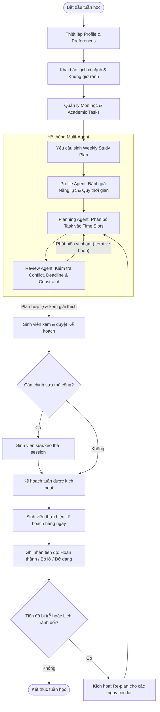

# Phân tích yêu cầu đã được duyệt

## Mục lục

- [Phân tích yêu cầu đã được duyệt](#phân-tích-yêu-cầu-đã-được-duyệt)
  - [Mục lục](#mục-lục)
  - [1. Introduction](#1-introduction)
  - [2. Problem Statement](#2-problem-statement)
    - [2.1 Current Situation](#21-current-situation)
    - [2.2 Problems](#22-problems)
    - [2.3 Project Objectives](#23-project-objectives)
    - [Decision gate: Khả năng truy cập API của UIT](#decision-gate-khả-năng-truy-cập-api-của-uit)
  - [3. Target Users \& Personas](#3-target-users--personas)
    - [Persona P1 – Regular Student (Sinh viên học tập tập trung)](#persona-p1--regular-student-sinh-viên-học-tập-tập-trung)
    - [Persona P2 – Working / Intern Student (Sinh viên vừa học vừa làm/thực tập)](#persona-p2--working--intern-student-sinh-viên-vừa-học-vừa-làmthực-tập)
    - [Persona P3 – Heavy Workload Student (Sinh viên đối mặt nhiều đồ án cao điểm)](#persona-p3--heavy-workload-student-sinh-viên-đối-mặt-nhiều-đồ-án-cao-điểm)
  - [4. User Needs](#4-user-needs)
  - [5. Main User Journey](#5-main-user-journey)
    - [5.1 Mô tả theo quy trình (Textual Flow)](#51-mô-tả-theo-quy-trình-textual-flow)
    - [5.2 Mermaid Flowchart](#52-mermaid-flowchart)
  - [6. Use Cases](#6-use-cases) — [Danh mục UC](use-case/use-cases.md), [template](use-case/use-case-template.md)
  - [7. Business Rules](#7-business-rules) — [Danh mục BR](business-rule/business-rules.md), [template](business-rule/business-rule-template.md)
  - [8. Functional Requirements](#8-functional-requirements) — [Danh mục FR](functional-requirement/functional-requirements.md), [template](functional-requirement/functional-requirement-template.md)
  - [9. Non-Functional Requirements](#9-non-functional-requirements)
  - [10. Assumptions](#10-assumptions)
  - [11. Constraints](#11-constraints)
  - [12. Initial Multi-Agent Responsibility Mapping](#12-initial-multi-agent-responsibility-mapping)
  - [13. Priority](#13-priority)

## 1. Introduction

Tài liệu này xác định tập yêu cầu phần mềm phiên bản v0.1 cho hệ thống Multi-Agent hỗ trợ sinh viên lập kế hoạch học tập cá nhân hóa. Trong môi trường đào tạo theo học chế tín chỉ tại Trường Đại học Công nghệ Thông tin – ĐHQG-HCM (UIT), sinh viên thường xuyên phải xử lý đồng thời nhiều đồ án môn học, bài tập lab và lịch trình cá nhân/việc làm. Hệ thống được xây dựng nhằm giải quyết bài toán quản trị thời gian tự học theo tuần mang tính thực tế và thích ứng linh hoạt khi có biến động.

Mục đích của tài liệu là thiết lập ranh giới phạm vi (Scope Boundary), phân tích nhu cầu người dùng, xác định các quy tắc nghiệp vụ (Business Rules), yêu cầu chức năng (Functional Requirements) và phi chức năng (Non-Functional Requirements) cho phiên bản khả dụng tối thiểu (MVP). Tài liệu đóng vai trò là kim chỉ nam kỹ thuật giúp 01 developer hiện thực hóa hệ thống trong thời lượng 13 tuần với nguồn lực thời gian bán thời gian (buổi tối).

Hệ thống định vị là công cụ hỗ trợ cá nhân hóa tự học, không thay thế hệ thống quản lý đào tạo và không phải là một hệ thống LMS (Learning Management System).

**Nguồn và trạng thái:** `docs/requirements_analysis_v0.1.md`, mục 1, được duyệt.

## 2. Problem Statement

### 2.1 Current Situation

Sinh viên UIT hiện phải tự điều phối một khối lượng công việc phân tán từ nhiều nguồn:

- Lịch học cố định trên lớp (lý thuyết, thực hành, kiểm tra tập trung).
- Bài tập định kỳ (assignments, lab sheets, weekly quiz).
- Đồ án môn học (course projects) kéo dài nhiều tuần với nhiều mốc nộp bài (milestones).
- Ôn tập kỳ thi giữa kỳ (midterm) và cuối kỳ (final exam).
- Lịch làm thêm hoặc thực tập doanh nghiệp (internship/part-time job) phổ biến ở sinh viên năm 3 và năm 4.
- Hoạt động sinh hoạt cá nhân, gia đình và nghỉ ngơi phục hồi thể lực.

### 2.2 Problems

1. **Mất cân đối định lượng giữa khối lượng công việc và quỹ thời gian thực tế:** Sinh viên ghi nhận danh sách deadline nhưng không định lượng được tổng số giờ cần thiết (estimated effort) so với tổng số giờ thực sự rảnh trong tuần, dẫn đến tình trạng vỡ kế hoạch không lường trước.
2. **Hành vi dồn việc vào sát hạn nộp (Crunch / Procrastination):** Các đồ án môn học lớn thường bị trì hoãn tới 1–2 ngày trước deadline mới bắt đầu thực hiện, gây ra tình trạng thức đêm, giảm sút chất lượng sản phẩm và kiệt sức (burnout).
3. **Xung đột ưu tiên trong các tuần cao điểm:** Khi có từ 3–5 deadline rơi vào cùng một tuần (điển hình là tuần 8 giữa kỳ hoặc tuần 14–16 cuối kỳ), sinh viên lúng túng trong việc quyết định thứ tự thực hiện các task để tối ưu kết quả học tập.
4. **Kế hoạch tĩnh bị gãy đổ khi có biến động thực tế:** Các phương pháp lập lịch thủ công (Google Calendar, Notion, sổ tay) không hỗ trợ cơ chế tái lập kế hoạch linh hoạt. Khi một buổi học bị lỡ hoặc task kéo dài hơn dự kiến, kế hoạch cho các ngày tiếp theo trở nên vô hiệu, khiến sinh viên nản lòng và từ bỏ việc theo dõi.
5. **Kế hoạch xung đột với nhịp sinh học và năng lực tiếp thu:** Lập lịch thiếu tính cá nhân hóa (ví dụ: xếp buổi tự học 4 tiếng liên tục sau 8 tiếng đi làm ban ngày) không khả thi về mặt sinh học, dẫn đến tỷ lệ bỏ dở kế hoạch cao.
6. **Kiệt quệ nhận thức (Decision Fatigue) mỗi ngày:** Sinh viên tiêu tốn thời gian và năng lượng tâm lý mỗi tối chỉ để suy nghĩ: "Hôm nay mình nên bắt đầu từ môn nào, làm trong bao lâu?".

### 2.3 Project Objectives

- **Mục tiêu chính (Primary Objective):** Xây dựng một giải pháp phần mềm MVP ứng dụng Multi-Agent hỗ trợ sinh viên UIT tự động lập và điều chỉnh kế hoạch học tập cá nhân theo chu kỳ tuần, đảm bảo tính khả thi về mặt thời gian, tôn trọng sở thích cá nhân và cung cấp giải thích logic phân bổ.
- **Mục tiêu phụ (Secondary Objectives):**
  1. Cho phép sinh viên quản lý tập trung lịch cố định, danh mục môn học và danh sách task học thuật trong một hệ thống gọn nhẹ.
  2. Tự động kiểm tra tính khả thi và cảnh báo xung đột (quá tải thời gian, trùng lịch bận, vi phạm deadline) trước khi sinh viên phê duyệt kế hoạch.
  3. Cung cấp cơ chế tự động tái lập lịch (Re-plan) thích ứng khi sinh viên ghi nhận tiến độ chậm hơn dự kiến hoặc thời gian rảnh thay đổi.
  4. Rút ngắn thời gian lập kế hoạch tuần của sinh viên xuống dưới 10 phút mỗi tuần.
  5. Cung cấp giải thích ngắn gọn, minh bạch cho từng quyết định phân bổ thời gian học tập của hệ thống.

### Decision gate: Khả năng truy cập API của UIT

- **Giả định tạm thời:** Hệ thống hiện tạm giả định rằng Trường Đại học Công nghệ Thông tin – ĐHQG-HCM (UIT) không cung cấp API để agent tự động lấy thông tin liên quan, chẳng hạn thời khóa biểu hoặc dữ liệu học tập.
- **Trạng thái:** Chưa được xác minh; đây là decision gate cần điều tra thêm, không phải dữ kiện đã xác nhận.
- **Cần làm rõ:** Xác minh với UIT và/hoặc qua tài liệu, đầu mối có thẩm quyền xem có API chính thức, điều kiện truy cập, phạm vi dữ liệu và chính sách sử dụng hay không.
- **Tác động đến quyết định:** Chưa chốt phương án tích hợp hay tự động trích xuất dữ liệu. Phạm vi MVP và cách nhập liệu cần được xem xét lại sau khi decision gate này được giải quyết.

**Nguồn và trạng thái:** `docs/requirements_analysis_v0.1.md`, mục 2, được duyệt. Ghi chú decision gate được bổ sung theo chỉ đạo của người duyệt; chưa phải kết luận về năng lực API thực tế của UIT.

## 3. Target Users & Personas

| ID  | Persona                                                         | Tóm tắt                                                                       | Đối tượng                                           | Trạng thái / nguồn                                                                         |
| --- | --------------------------------------------------------------- | ----------------------------------------------------------------------------- | --------------------------------------------------- | ------------------------------------------------------------------------------------------ |
| P1  | Regular Student (Sinh viên học tập tập trung)                   | Sinh viên học toàn thời gian, cần duy trì nhịp học đều và chia nhỏ đồ án.     | Sinh viên năm 2–3                                   | Được duyệt; `docs/requirements_analysis_v0.1.md`, mục 4. Persona giả định, cần kiểm chứng. |
| P2  | Working / Intern Student (Sinh viên vừa học vừa làm/thực tập)   | Sinh viên có ít thời gian tự học, cần tôn trọng lịch làm và cảnh báo quá tải. | Sinh viên năm 3–4 vừa học vừa làm/thực tập          | Được duyệt; `docs/requirements_analysis_v0.1.md`, mục 4. Persona giả định, cần kiểm chứng. |
| P3  | Heavy Workload Student (Sinh viên đối mặt nhiều đồ án cao điểm) | Sinh viên có nhiều đồ án, deadline tập trung và nhu cầu tái lập kế hoạch.     | Sinh viên trong học kỳ chuyên ngành có workload cao | Được duyệt; `docs/requirements_analysis_v0.1.md`, mục 4. Persona giả định, cần kiểm chứng. |

### Persona P1 – Regular Student (Sinh viên học tập tập trung)

- **Context:** Sinh viên năm 2 hoặc năm 3, học toàn thời gian tại cơ sở UIT (Thủ Đức). Đăng ký từ 18–21 tín chỉ, không đi làm thêm ngoài giờ. Tham gia đều đặn các buổi học lý thuyết và thực hành trên giảng đường.
- **Pain Points:**
  - Dễ chủ quan vì thấy quỹ thời gian buổi tối và cuối tuần còn nhiều.
  - Trì hoãn các bài tập lớn/đồ án môn học đến sát deadline.
  - Mất tập trung vào mạng xã hội buổi tối do không có mục tiêu cụ thể cho từng khung giờ.
- **Goals:** Tạo lập thói quen học tập đều đặn mỗi ngày; hoàn thành đồ án từng bước để đạt điểm cao; không bị thức đêm trong tuần thi cử.
- **Typical Availability:**
  - Thứ 2 – Thứ 6: 19:00 – 23:00 (khoảng 3–4 tiếng/tối).
  - Thứ 7 – Chủ Nhật: 08:30 – 11:30 và 14:00 – 17:30 (khoảng 6–7 tiếng/ngày).
- **Expectation from System:** Hệ thống đưa ra checklist rõ ràng từng tối: học môn gì, làm task nào, thời lượng bao nhiêu phút; tự động chia nhỏ các đồ án dài hạn.

### Persona P2 – Working / Intern Student (Sinh viên vừa học vừa làm/thực tập)

- **Context:** Sinh viên năm 3 hoặc năm 4, đăng ký từ 12–15 tín chỉ tại UIT kết hợp thực tập hoặc làm việc bán thời gian tại doanh nghiệp công nghệ (khoảng 35-40 giờ/tuần).
- **Pain Points:**
  - Quỹ thời gian học tự do cực kỳ hạn chế và manh mún.
  - Sau ngày làm việc tại công ty thường mệt mỏi, khó tiếp thu bài vở nếu bị xếp lịch học quá dài hoặc quá muộn.
  - Dễ bỏ sót các deadline bài tập nhỏ trên lớp do tập trung vào công việc tại công ty.
- **Goals:** Tối ưu hóa từng giờ tự học ít ỏi; đảm bảo nộp bài đúng hạn và qua môn tốt mà không ảnh hưởng tới chất lượng công việc doanh nghiệp.
- **Typical Availability:**
  - Thứ 2 – Thứ 6: 20:30 – 23:00 (khoảng 1.5–2 tiếng/tối sau khi đi làm về và ăn uống).
  - Thứ 7: 13:30 – 17:30 (4 tiếng).
  - Chủ Nhật: Dành nghỉ ngơi hoặc chỉ học tối đa 2–3 tiếng.
- **Expectation from System:** Hệ thống tôn trọng tuyệt đối các slot bận (lịch làm việc, thời gian di chuyển, nghỉ ngơi); ưu tiên các task cận hạn; cảnh báo ngay khi khối lượng bài tập vượt quá tổng số giờ rảnh còn lại trong tuần.

### Persona P3 – Heavy Workload Student (Sinh viên đối mặt nhiều đồ án cao điểm)

- **Context:** Sinh viên đang trong học kỳ chuyên ngành nặng (ví dụ: Chuyên ngành Kỹ thuật phần mềm, Hệ thống thông tin...), gánh đồng thời 3–4 môn có đồ án lớn (project-based), phải phối hợp làm việc nhóm với các bạn cùng lớp.
- **Pain Points:**
  - Xung đột deadline tập trung vào các tuần 8–10 (báo cáo giữa kỳ) và tuần 14–16 (bảo vệ cuối kỳ).
  - Khi một đồ án phát sinh sự cố mất thêm thời gian (debug, họp nhóm đột xuất), toàn bộ kế hoạch tự học của các môn còn lại bị đổ vỡ dây chuyền.
  - Khó khăn trong việc cân bằng nỗ lực giữa môn điểm số quan trọng và môn phụ.
- **Goals:** Tránh bị trễ hạn các mốc nộp đồ án; kiểm soát được tiến độ công việc hàng ngày; tái lập lịch tức thì khi bị trễ kế hoạch.
- **Typical Availability:**
  - Lịch học trên lớp và lịch họp nhóm biến động linh hoạt theo tuần.
  - Sẵn sàng học dồn 5–6 tiếng vào các ngày không có lịch thực hành.
- **Expectation from System:** Hỗ trợ tính năng Re-plan nhanh chóng khi không hoàn thành phiên học; tự động điều phối thứ tự ưu tiên dựa trên mức độ quan trọng và deadline của từng đồ án.

**Nguồn và trạng thái:** `docs/requirements_analysis_v0.1.md`, mục 4, được duyệt. Các persona là mô hình đại diện giả định; các đặc điểm và availability cần được kiểm chứng với sinh viên UIT.

## 4. User Needs

| ID | Nhu cầu | Tóm tắt | Đối tượng | Trạng thái / nguồn |
|---|---|---|---|---|
| UN-01 | Lập kế hoạch theo thời gian rảnh | Biết task cần tập trung trong từng ngày/buổi dựa trên thời gian rảnh thực tế. | Sinh viên | Được duyệt; `docs/requirements_analysis_v0.1.md`, mục 5. |
| UN-02 | Tránh xung đột lịch | Kế hoạch không trùng lịch học, làm việc/thực tập và thời gian cá nhân đã khai báo. | Sinh viên | Được duyệt; `docs/requirements_analysis_v0.1.md`, mục 5. |
| UN-03 | Cảnh báo quá tải | Được cảnh báo khi tổng effort ước lượng vượt thời gian rảnh trong tuần. | Sinh viên | Được duyệt; `docs/requirements_analysis_v0.1.md`, mục 5. |
| UN-04 | Chia nhỏ task lớn | Chia đồ án/bài tập lớn thành nhiều study session trước deadline. | Sinh viên | Được duyệt; `docs/requirements_analysis_v0.1.md`, mục 5. |
| UN-05 | Tuân thủ sở thích và giới hạn | Kế hoạch tôn trọng sở thích và giới hạn cá nhân về thời lượng, số giờ và khung giờ học. | Sinh viên | Được duyệt; `docs/requirements_analysis_v0.1.md`, mục 5. |
| UN-06 | Giải thích phân bổ | Biết lý do ngắn gọn hệ thống xếp task vào một khung giờ cụ thể. | Sinh viên | Được duyệt; `docs/requirements_analysis_v0.1.md`, mục 5. |
| UN-07 | Chỉnh sửa kế hoạch | Có thể di chuyển, đổi lịch hoặc xóa study session do hệ thống tạo. | Sinh viên | Được duyệt; `docs/requirements_analysis_v0.1.md`, mục 5. |
| UN-08 | Ghi nhận tiến độ | Ghi nhận trạng thái hoàn thành hoặc thời gian thực tế đã học cho từng session. | Sinh viên | Được duyệt; `docs/requirements_analysis_v0.1.md`, mục 5. |
| UN-09 | Tái lập kế hoạch | Lập lại kế hoạch cho thời gian còn lại khi lỡ session hoặc thời gian rảnh thay đổi. | Sinh viên | Được duyệt; `docs/requirements_analysis_v0.1.md`, mục 5. |
| UN-10 | Quản lý dữ liệu học tập | Quản lý tập trung môn học, task học thuật và deadline tương ứng. | Sinh viên | Được duyệt; `docs/requirements_analysis_v0.1.md`, mục 5. |
| UN-11 | Đánh dấu mức độ quan trọng của task | Gán hệ số mức độ quan trọng từ 1 đến 5, cho phép giá trị theo bước 0,1. | Sinh viên | Được duyệt theo chỉ đạo người dùng bổ sung vào mục 5. |
| UN-12 | Ước lượng thời gian hoàn thành task | Nhập thời gian hoàn thành ước lượng theo giờ hoặc yêu cầu hệ thống đưa ra ước lượng theo giờ. | Sinh viên | Được duyệt theo chỉ đạo người dùng bổ sung vào mục 5. |

### UN-01 – Lập kế hoạch theo thời gian rảnh

Sinh viên cần biết cụ thể trong mỗi ngày/buổi học mình nên tập trung làm task nào dựa trên quỹ thời gian rảnh thực tế.

### UN-02 – Tránh xung đột lịch

Sinh viên cần kế hoạch học tập không bị trùng lặp (conflict) với lịch học trên trường, lịch làm việc/thực tập và các khung thời gian cá nhân đã xác định.

### UN-03 – Cảnh báo quá tải

Sinh viên cần hệ thống tự động cảnh báo sớm khi tổng số giờ ước lượng của các task vượt quá tổng thời gian rảnh trong tuần (quá tải lịch trình).

### UN-04 – Chia nhỏ task lớn

Sinh viên cần các đồ án/bài tập lớn được hệ thống hỗ trợ chia thành nhiều phiên học (study sessions) rải đều trong tuần trước deadline thay vì dồn vào ngày nộp.

### UN-05 – Tuân thủ sở thích và giới hạn

Sinh viên cần kế hoạch học tập tuân thủ theo các sở thích và giới hạn cá nhân (ví dụ: thời lượng tối đa mỗi phiên học, số giờ học tối đa trong ngày, thời điểm học ưa thích).

### UN-06 – Giải thích phân bổ

Sinh viên cần biết lý do ngắn gọn vì sao hệ thống lại sắp xếp một task vào một khung giờ cụ thể để cảm thấy tin tưởng và có động lực thực hiện.

### UN-07 – Chỉnh sửa kế hoạch

Sinh viên cần có quyền can thiệp, chỉnh sửa thủ công (di chuyển, đổi lịch, xóa) các phiên học do hệ thống sinh ra khi cảm thấy chưa phù hợp với hoàn cảnh thực tế.

### UN-08 – Ghi nhận tiến độ

Sinh viên cần ghi nhận trạng thái hoàn thành hoặc số giờ thực tế đã học của từng phiên học một cách đơn giản, nhanh chóng.

### UN-09 – Tái lập kế hoạch

Sinh viên cần hệ thống tự động tái lập kế hoạch (re-plan) cho những ngày còn lại trong tuần khi một phiên học bị bỏ lỡ hoặc khi quỹ thời gian rảnh thay đổi đột xuất.

### UN-10 – Quản lý dữ liệu học tập

Sinh viên cần lưu trữ và quản lý tập trung danh mục môn học, các loại task học thuật (bài tập, đồ án, ôn thi) và hạn nộp tương ứng tại một giao diện trực quan.

### UN-11 – Đánh dấu mức độ quan trọng của task

Sinh viên cần có thể gán cho task một hệ số mức độ quan trọng từ 1 đến 5, với độ chính xác đến một chữ số thập phân (bước 0,1).

### UN-12 – Ước lượng thời gian hoàn thành task

Sinh viên cần có thể tự nhập thời gian hoàn thành task ước lượng theo giờ hoặc yêu cầu hệ thống ước lượng thời gian đó theo giờ.

**Nguồn và trạng thái:** UN-01–UN-10 được duyệt từ `docs/requirements_analysis_v0.1.md`, mục 5. UN-11–UN-12 được duyệt theo chỉ đạo người dùng trong lần duyệt này; cách hệ thống ước lượng thời gian và cơ sở ước lượng vẫn cần được đặc tả, chưa được xác định ở đây.

## 5. Main User Journey

### 5.1 Mô tả theo quy trình (Textual Flow)

1. **Initial Setup & Profile:** Sinh viên thiết lập hồ sơ cá nhân cơ bản và cấu hình sở thích học tập (thời lượng mong muốn cho một phiên học, số giờ học tối đa mỗi ngày, khung thời gian học ưa thích).
2. **Fixed Schedule & Availability:** Sinh viên khai báo lịch cố định hàng tuần (lịch học trên trường, lịch đi làm/thực tập) và đánh dấu các khung giờ bận cá nhân. Hệ thống tính toán ra các khoảng thời gian rảnh khả dụng (Available Study Slots).
3. **Courses & Tasks Definition:** Sinh viên tạo danh sách môn học trong kỳ và nhập danh sách task học thuật cần xử lý (tên task, môn học, deadline, estimated effort, mức độ ưu tiên).
4. **Plan Generation Request:** Sinh viên kích hoạt yêu cầu tạo kế hoạch học tập cho tuần mục tiêu.
5. **System Generation & Review Loop:** Planning Agent dự thảo phân bổ các task vào các slot rảnh; Review Agent kiểm tra tính hợp lệ (trùng lịch, vi phạm deadline, quá tải, tuân thủ preference). Nếu có lỗi, Planning Agent tinh chỉnh lại trước khi trả về kết quả.
6. **Student Review & Confirmation:** Sinh viên xem bản kế hoạch tuần được đề xuất kèm giải thích lý do phân bổ. Sinh viên có thể chấp thuận hoặc điều chỉnh thủ công các phiên học.
7. **Execution & Daily Progress Tracking:** Trong tuần, sinh viên mở kế hoạch theo ngày, bấm bắt đầu/hoàn thành hoặc cập nhật tiến độ thực tế (ví dụ: task hoàn thành 50%, hoặc phiên học bị bỏ lỡ).
8. **Dynamic Re-planning:** Khi xảy ra sai lệch tiến độ hoặc lịch bận thay đổi, sinh viên kích hoạt tính năng Re-plan. Hệ thống đánh giá lại khối lượng công việc còn lại và phân bổ lại lịch cho các ngày còn lại trong tuần.

### 5.2 Mermaid Flowchart

**Nguồn và trạng thái:** `docs/requirements_analysis_v0.1.md`, mục 6, được duyệt.

## 6. Use Cases

| ID | Use Case | Actor | Tóm tắt |
|---|---|---|---|
| [UC-01](use-case/use-cases.md#uc-01-manage-student-profile) | Manage Student Profile | Sinh viên | Tạo, xem và cập nhật hồ sơ học tập cùng sở thích học tập. |
| [UC-02](use-case/use-cases.md#uc-02-manage-availability) | Manage Availability | Sinh viên | Khai báo, chỉnh sửa và xóa thời gian bận để xác định slot rảnh. |
| [UC-03](use-case/use-cases.md#uc-03-manage-courses) | Manage Courses | Sinh viên | Quản lý danh mục môn học trong học kỳ. |
| [UC-04](use-case/use-cases.md#uc-04-manage-academic-tasks) | Manage Academic Tasks | Sinh viên | Tạo, xem, sửa và hủy task học thuật. |
| [UC-05](use-case/use-cases.md#uc-05-generate-weekly-study-plan) | Generate Weekly Study Plan | Sinh viên | Yêu cầu hệ thống sinh kế hoạch học tập theo tuần. |
| [UC-06](use-case/use-cases.md#uc-06-review-generated-plan) | Review Generated Plan | Sinh viên | Xem xét, điều chỉnh hoặc xác nhận kế hoạch được đề xuất. |
| [UC-07](use-case/use-cases.md#uc-07-modify-study-plan) | Modify Study Plan | Sinh viên | Điều chỉnh các phiên học trong kế hoạch tuần. |
| [UC-08](use-case/use-cases.md#uc-08-record-progress) | Record Progress | Sinh viên | Ghi nhận kết quả thực tế sau mỗi phiên học. |
| [UC-09](use-case/use-cases.md#uc-09-re-plan-study-schedule) | Re-plan Study Schedule | Sinh viên | Tính và phân bổ lại các phiên học chưa hoàn thành. |
| [UC-10](use-case/use-cases.md#uc-10-explain-planning-decision) | Explain Planning Decision | Sinh viên | Xem giải thích cho quyết định phân bổ hoặc ưu tiên task. |

**Nguồn và trạng thái:** `docs/requirements_analysis_v0.1.md`, mục 7, được duyệt. Theo chỉ đạo, tài liệu chung chỉ liệt kê danh sách UC; đặc tả chi tiết từng UC không được sao chép vào đây.

## 7. Business Rules

| ID | Nhóm | Tóm tắt | Chi tiết |
|---|---|---|---|
| BR-PLAN-001 | Lập lịch | AI không xếp trùng khung bận; ngoại lệ chỉ theo xác nhận người dùng và audit. | [BR-PLAN-001](business-rule/scheduling-rules.md#br-plan-001) |
| BR-PLAN-002 | Lập lịch | Tổng thời lượng học mỗi ngày không vượt giới hạn hồ sơ. | [BR-PLAN-002](business-rule/scheduling-rules.md#br-plan-002) |
| BR-PLAN-003 | Lập lịch | Thời lượng session trong giới hạn tối thiểu/tối đa. | [BR-PLAN-003](business-rule/scheduling-rules.md#br-plan-003) |
| BR-PLAN-004 | Lập lịch | Session kết thúc trước deadline của task. | [BR-PLAN-004](business-rule/scheduling-rules.md#br-plan-004) |
| BR-PLAN-005 | Lập lịch | Task lớn được chia thành nhiều session. | [BR-PLAN-005](business-rule/scheduling-rules.md#br-plan-005) |
| BR-PLAN-006 | Lập lịch | Khi thiếu giờ, ưu tiên deadline rồi hệ số quan trọng của task; không dùng trọng số môn học. | [BR-PLAN-006](business-rule/scheduling-rules.md#br-plan-006) |
| BR-PLAN-007 | Lập lịch | Có buffer giữa session cùng ngày, trừ chỉnh sửa thủ công. | [BR-PLAN-007](business-rule/scheduling-rules.md#br-plan-007) |
| BR-PLAN-008 | Lập lịch | Re-plan không tự di dời session trong quá khứ. | [BR-PLAN-008](business-rule/scheduling-rules.md#br-plan-008) |
| BR-USER-001 | Quyền người dùng | Sinh viên có quyền chỉnh sửa session được sinh tự động. | [BR-USER-001](business-rule/user-control-rules.md#br-user-001) |
| BR-USER-002 | Quyền người dùng | AI không tự sửa deadline hoặc tên task. | [BR-USER-002](business-rule/user-control-rules.md#br-user-002) |
| BR-USER-003 | Quyền người dùng | Cảnh báo; chỉ user được xác nhận ghi đè giờ bận và hành động được audit. | [BR-USER-003](business-rule/user-control-rules.md#br-user-003) |
| BR-USER-004 | Quyền người dùng | Session bị khóa không tự di dời khi Re-plan. | [BR-USER-004](business-rule/user-control-rules.md#br-user-004) |
| BR-USER-005 | Quyền người dùng | Kế hoạch chỉ áp dụng sau Apply / Confirm. | [BR-USER-005](business-rule/user-control-rules.md#br-user-005) |
| BR-PROGRESS-001 | Tiến độ | Task Completed bị loại khỏi các lần Plan / Re-plan sau. | [BR-PROGRESS-001](business-rule/progress-tracking-rules.md#br-progress-001) |
| BR-PROGRESS-002 | Tiến độ | Effort đã học được trừ khỏi effort còn lại và tái phân bổ. | [BR-PROGRESS-002](business-rule/progress-tracking-rules.md#br-progress-002) |
| BR-PROGRESS-003 | Tiến độ | Session Missed/chưa hoàn thành được đưa vào Re-plan. | [BR-PROGRESS-003](business-rule/progress-tracking-rules.md#br-progress-003) |
| BR-PROGRESS-004 | Tiến độ | Re-plan bắt đầu từ hiện tại và giữ nguyên session Completed. | [BR-PROGRESS-004](business-rule/progress-tracking-rules.md#br-progress-004) |

**Nguồn và trạng thái:** `docs/requirements_analysis_v0.1.md`, mục 8, toàn bộ BR-PLAN-001–008, BR-USER-001–005 và BR-PROGRESS-001–004 được duyệt theo chỉ đạo người dùng. Xem [mục lục đặc tả theo nhóm](business-rule/business-rules.md) và [mẫu BR](business-rule/business-rule-template.md).

## 8. Functional Requirements

| ID | Yêu cầu | Tóm tắt | Nguồn | Chi tiết |
|---|---|---|---|---|
| FR-PROFILE-001 | Quản lý thông tin học tập cá nhân | Tạo, xem và cập nhật hồ sơ cơ bản. | Mục 9.1 | [Chi tiết](functional-requirement/profile-preferences.md#fr-profile-001) |
| FR-PROFILE-002 | Cấu hình sở thích và tham số lập lịch | Cấu hình thời lượng session, giờ học tối đa và khung giờ ưa thích. | Mục 9.1 | [Chi tiết](functional-requirement/profile-preferences.md#fr-profile-002) |
| FR-SCHEDULE-001 | Khai báo khung giờ bận cố định | Quản lý khung giờ bận lặp lại theo tuần. | Mục 9.2 | [Chi tiết](functional-requirement/schedule-availability.md#fr-schedule-001) |
| FR-SCHEDULE-002 | Tự động tính toán quỹ thời gian rảnh | Tính và hiển thị Available Slots từ lịch bận và giờ nghỉ. | Mục 9.2 | [Chi tiết](functional-requirement/schedule-availability.md#fr-schedule-002) |
| FR-SCHEDULE-003 | Thiết lập ngoại lệ theo ngày | Đánh dấu bận đột xuất mà không đổi lịch lặp hàng tuần. | Mục 9.2 | [Chi tiết](functional-requirement/schedule-availability.md#fr-schedule-003) |
| FR-TASK-001 | Quản lý danh mục môn học | Thêm, sửa, xóa và hiển thị môn học trong học kỳ. | Mục 9.3 | [Chi tiết](functional-requirement/course-task-management.md#fr-task-001) |
| FR-TASK-002 | Quản lý danh sách task học thuật | Lưu hệ số quan trọng 1,0–5,0 theo bước 0,1 cùng thông tin task. | Mục 9.3 | [Chi tiết](functional-requirement/course-task-management.md#fr-task-002) |
| FR-TASK-003 | Cập nhật và lưu vết Remaining Effort | Duy trì effort còn lại, khởi tạo từ estimate và giảm khi hoàn thành session. | Mục 9.3 | [Chi tiết](functional-requirement/course-task-management.md#fr-task-003) |
| FR-TASK-004 | Phân loại trạng thái vòng đời của Task | Theo dõi Pending, In Progress, Completed và Overdue. | Mục 9.3 | [Chi tiết](functional-requirement/course-task-management.md#fr-task-004) |
| FR-PLAN-001 | Tự động sinh kế hoạch học tập tuần | Phân bổ task tồn đọng vào slot rảnh thành Weekly Study Plan. | Mục 9.4 | [Chi tiết](functional-requirement/planning-generation.md#fr-plan-001) |
| FR-PLAN-002 | Tự động chia nhỏ task lớn thành nhiều Study Session | Chia task lớn thành sessions trước deadline. | Mục 9.4 | [Chi tiết](functional-requirement/planning-generation.md#fr-plan-002) |
| FR-PLAN-003 | Kiểm thử xung đột và ràng buộc | Rà soát lịch và lặp điều chỉnh tối đa 3 lần khi phát hiện vi phạm. | Mục 9.4 | [Chi tiết](functional-requirement/planning-generation.md#fr-plan-003) |
| FR-PLAN-004 | Cảnh báo quá tải và nguy cơ trễ hạn | Cảnh báo khi effort vượt giờ rảnh và liệt kê task rủi ro. | Mục 9.4 | [Chi tiết](functional-requirement/planning-generation.md#fr-plan-004) |
| FR-PLAN-005 | Khóa cố định phiên học | MUST trong MVP: cho phép ghim session để giữ nguyên giờ khi Re-plan. | Mục 9.4 | [Chi tiết](functional-requirement/planning-generation.md#fr-plan-005) |
| FR-MODIFY-001 | Chỉnh sửa trực tiếp phiên học trên lịch | Đổi ngày/giờ session và cảnh báo xung đột lịch bận. | Mục 9.5 | [Chi tiết](functional-requirement/plan-modification.md#fr-modify-001) |
| FR-MODIFY-002 | Xóa hoặc thêm mới phiên học thủ công | Thêm/xóa session chỉ cập nhật kế hoạch, không làm đổi Remaining Effort. | Mục 9.5 | [Chi tiết](functional-requirement/plan-modification.md#fr-modify-002) |
| FR-PROGRESS-001 | Ghi nhận hoàn thành phiên học | Đánh dấu Completed và giảm Remaining Effort theo thời lượng. | Mục 9.6 | [Chi tiết](functional-requirement/progress-tracking.md#fr-progress-001) |
| FR-PROGRESS-002 | Ghi nhận tiến độ dở dang hoặc bỏ lỡ phiên học | Ghi nhận thời lượng thực tế hoặc Missed. | Mục 9.6 | [Chi tiết](functional-requirement/progress-tracking.md#fr-progress-002) |
| FR-PROGRESS-003 | Tổng kết tiến độ tuần | Hiển thị giờ học thực tế/kế hoạch và tỷ lệ hoàn thành. | Mục 9.6 | [Chi tiết](functional-requirement/progress-tracking.md#fr-progress-003) |
| FR-REPLAN-001 | Tái lập kế hoạch động khi có biến động | Sắp xếp task chưa hoàn thành từ hiện tại tới cuối tuần. | Mục 9.7 | [Chi tiết](functional-requirement/replanning.md#fr-replan-001) |
| FR-REPLAN-002 | Tự động kích hoạt đề xuất Re-plan khi có sai lệch | Gợi ý Re-plan khi có từ 2 session Missed hoặc lịch bận mới. | Mục 9.7 | [Chi tiết](functional-requirement/replanning.md#fr-replan-002) |
| FR-EXPLAIN-001 | Giải thích lý do phân bổ phiên học | Cung cấp giải thích ngắn về căn cứ xếp session. | Mục 9.8 | [Chi tiết](functional-requirement/explanation-transparency.md#fr-explain-001) |
| FR-EXPLAIN-002 | Tóm tắt chiến lược lập lịch tuần | Tóm tắt chiến lược học trong tuần, tối đa 100 từ. | Mục 9.8 | [Chi tiết](functional-requirement/explanation-transparency.md#fr-explain-002) |

**Nguồn và trạng thái:** `docs/requirements_analysis_v0.1.md`, mục 9, 23 yêu cầu FR được duyệt theo chỉ đạo người dùng. Xem [mục lục đặc tả theo nhóm](functional-requirement/functional-requirements.md). Các nhóm khác, bao gồm NFR, Data Requirements và MoSCoW, vẫn ngoài phạm vi duyệt lần này. Mẫu: [FR template](functional-requirement/functional-requirement-template.md). Mẫu BR: [BR template](business-rule/business-rule-template.md).

## 9. Non-Functional Requirements

| ID | Thuộc tính | Tóm tắt | Nguồn |
|---|---|---|---|
| NFR-USAB-01 | Usability — Thời gian tạo kế hoạch | Tạo và duyệt kế hoạch tuần trong dưới 05 phút. | Mục 11 |
| NFR-USAB-02 | Usability — Trực quan hóa lịch | Weekly Time-grid phân biệt lịch học, làm và Study Session bằng màu. | Mục 11 |
| NFR-PERF-01 | Performance — Thời gian sinh kế hoạch | Hiển thị dự thảo dưới 15 giây với tối đa 10 môn, 25 task; cần benchmark API LLM. | Mục 11 |
| NFR-PERF-02 | Performance — Thời gian phản hồi giao diện | Check-in và cập nhật tiến độ phản hồi dưới 500ms. | Mục 11 |
| NFR-REL-01 | Reliability — Không mất mát dữ liệu kế hoạch | Tự lưu trạng thái kế hoạch và tiến độ sau mỗi thao tác. | Mục 11 |
| NFR-AI-01 | AI Reliability — Ràng buộc cứng | AI không trùng lịch bận, không xếp sau deadline; đạt 100% qua validator xác định. User override được xác nhận và audit. | Mục 11 |
| NFR-AI-02 | AI Robustness — Xử lý lỗi API | Không crash khi API lỗi; báo thân thiện và dùng fallback. | Mục 11 |
| NFR-EXPL-01 | Explainability — Tính dễ hiểu của giải thích | Giải thích tiếng Việt tự nhiên 20–60 từ, tập trung thời gian, deadline, ưu tiên. | Mục 11 |
| NFR-PRIV-01 | Privacy — Bảo mật dữ liệu cá nhân | Thu thập tối thiểu và khử định danh dữ liệu trước khi gửi API AI. | Mục 11 |
| NFR-MAINT-01 | Maintainability — Tính độc lập của Module | Tách UI, deterministic rules và AI agents để dễ bảo trì. | Mục 11 |

### NFR-USAB-01 (Usability — Thời gian tạo kế hoạch)

Giao diện và luồng thao tác phải được thiết kế tối giản sao cho một sinh viên đã có sẵn lịch và task có thể hoàn tất việc yêu cầu và duyệt một kế hoạch tuần mới trong vòng **dưới 05 phút**.

### NFR-USAB-02 (Usability — Trực quan hóa lịch)

Kế hoạch học tập tuần phải được hiển thị dưới dạng biểu đồ lịch trực quan (Weekly Time-grid), cho phép phân biệt rõ ràng giữa khung giờ học trên lớp, khung giờ đi làm và các Study Session thông qua mã màu.

### NFR-PERF-01 (Performance — Thời gian sinh kế hoạch)

Với khối lượng công việc thông thường của một sinh viên (tối đa 10 môn học, 25 task tồn đọng trong tuần), thời gian từ khi sinh viên bấm "Tạo kế hoạch" đến khi hệ thống hiển thị bản dự thảo kế hoạch tuần hoàn chỉnh phải **dưới 15 giây** trong điều kiện mạng thông thường. **TBD — cần benchmark thực tế với API LLM.**

### NFR-PERF-02 (Performance — Thời gian phản hồi giao diện)

Các thao tác chuyển đổi trạng thái phiên học (Check-in hoàn thành, ghi nhận tiến độ) phải phản hồi trên giao diện người dùng trong vòng **dưới 500ms**.

### NFR-REL-01 (Reliability — Không mất mát dữ liệu kế hoạch)

Hệ thống phải tự động lưu lại trạng thái kế hoạch và tiến độ học tập ngay sau mỗi thao tác của người dùng, đảm bảo không bị mất dữ liệu khi sinh viên tải lại trang hoặc đóng ứng dụng.

### NFR-AI-01 (AI Reliability — Ràng buộc cứng 100% không vi phạm)

Các kế hoạch do AI tạo hoặc tự điều chỉnh phải tuân thủ 100% các ràng buộc cứng: *không xếp trùng vào lịch bận cố định* và *không xếp phiên học sau deadline*. Deterministic Rule Validator phải kiểm tra các ràng buộc này trước khi kế hoạch được hiển thị cho người dùng. AI không được tự tạo ngoại lệ cho lịch bận. Sinh viên có thể chủ động ghi đè xung đột lịch bận theo BR-USER-003 sau cảnh báo và xác nhận rõ ràng; hành động ghi đè phải được ghi vào audit log và được phân biệt với kết quả do AI tạo.

### NFR-AI-02 (AI Robustness — Xử lý lỗi API)

Khi kết nối tới dịch vụ mô hình ngôn ngữ lớn (LLM API) bị gián đoạn, quá hạn (timeout) hoặc vượt hạn mức (rate limit), hệ thống không được sụp đổ (crash) mà phải thông báo lỗi thân thiện và chuyển sang chế độ dự phòng (fallback: thông báo sinh viên thử lại hoặc xếp lịch theo rule-based đơn giản).

### NFR-EXPL-01 (Explainability — Tính dễ hiểu của giải thích)

Mọi lời giải thích phân bổ (do Explainability module sinh ra) phải bằng tiếng Việt tự nhiên, có độ dài từ 20 đến 60 từ, tập trung hoàn toàn vào yếu tố thời gian, deadline và ưu tiên, không được sinh ra văn bản vô nghĩa hoặc ảo giác (hallucination).

### NFR-PRIV-01 (Privacy — Bảo mật dữ liệu cá nhân)

Hệ thống chỉ thu thập các thông tin tối thiểu phục vụ lập lịch (tên môn, deadline, thời gian bận). Không thu thập mật khẩu, thông tin tài khoản ngân hàng hay thông tin học vụ nhạy cảm khác. Dữ liệu gửi lên API AI phải được khử định danh cá nhân (anonymized).

### NFR-MAINT-01 (Maintainability — Tính độc lập của Module)

Kiến trúc mã nguồn phải phân tách rõ ràng giữa tầng giao diện người dùng, tầng xử lý quy tắc nghiệp vụ xác định (deterministic rules) và tầng tương tác với các Agent AI để phục vụ việc bảo trì và nâng cấp bởi 01 developer.

**Nguồn và trạng thái:** `docs/requirements_analysis_v0.1.md`, mục 11, NFR-USAB-01 đến NFR-MAINT-01 (10 yêu cầu) được duyệt theo chỉ đạo người dùng. TBD về benchmark NFR-PERF-01 vẫn cần xác minh.

## 10. Assumptions

| # | Giả định | Tóm tắt | Nguồn |
|---|---|---|---|
| 1 | Tính chính xác của dữ liệu đầu vào | Sinh viên nhập deadline và ước lượng effort tương đối chính xác. | Mục 12 |
| 2 | Cam kết cập nhật tiến độ | Sinh viên truy cập ít nhất một lần mỗi ngày để cập nhật hoặc Re-plan. | Mục 12 |
| 3 | Cơ chế nhập liệu thủ công trong MVP | Sinh viên chấp nhận nhập tay hoặc import đơn giản, không bắt buộc đồng bộ Portal UIT. | Mục 12 |
| 4 | Môi trường hạ tầng có kết nối Internet | Ứng dụng có Internet ổn định cho AI agents và cloud storage. | Mục 12 |
| 5 | Đơn vị lập lịch là Tuần | Chu kỳ lập kế hoạch là Thứ Hai đến Chủ Nhật. | Mục 12 |

1. **Tính chính xác của dữ liệu đầu vào:** Giả định rằng sinh viên cung cấp tương đối chính xác mốc Deadline và có khả năng ước lượng tương đối khối lượng thời gian cần thiết (Estimated Effort) cho các task của mình.
2. **Cam kết cập nhật tiến độ:** Giả định rằng sinh viên có động lực tự thân và sẽ chủ động truy cập hệ thống ít nhất 1 lần/ngày để cập nhật trạng thái các phiên học hoặc kích hoạt Re-plan khi có sai lệch.
3. **Cơ chế nhập liệu thủ công trong MVP:** Giả định rằng trong phạm vi MVP phiên bản đầu tiên, sinh viên hoàn toàn chấp nhận việc nhập lịch học và bài tập bằng tay (manual entry) hoặc import danh sách đơn giản, không bắt buộc hệ thống phải tự đồng bộ tự động từ Portal UIT.
4. **Môi trường hạ tầng có kết nối Internet:** Giả định rằng ứng dụng chạy trong môi trường có kết nối Internet ổn định để giao tiếp với các dịch vụ AI Agent và lưu trữ đám mây.
5. **Đơn vị lập lịch là Tuần:** Giả định rằng chu kỳ quản lý học tập thực tế và hiệu quả nhất đối với sinh viên đại học là theo từng tuần (Weekly Horizon, từ Thứ Hai đến Chủ Nhật).

**Nguồn và trạng thái:** `docs/requirements_analysis_v0.1.md`, mục 12, toàn bộ 5 assumptions được duyệt theo chỉ đạo người dùng.

## 11. Constraints

| # | Constraint | Tóm tắt | Nguồn |
|---|---|---|---|
| 1 | Giới hạn nguồn lực phát triển (Team Size 1) | Dự án do một developer thực hiện toàn bộ vòng đời. | Mục 13 |
| 2 | Giới hạn thời gian cố định 13 tuần | Bàn giao và nghiệm thu trong 13 tuần của học kỳ. | Mục 13 |
| 3 | Quỹ thời gian làm việc bán thời gian | Dự kiến 10–15 giờ/tuần cho dự án. | Mục 13 |
| 4 | Hạn mức tài nguyên và chi phí AI API | Ngân sách LLM hạn chế, cần tối ưu prompt, số lượt gọi và context. | Mục 13 |
| 5 | Yêu cầu bắt buộc về tính ổn định khi Demo | Cần kịch bản demo ổn định, không treo hoặc phụ thuộc dịch vụ khó kiểm soát. | Mục 13 |

1. **Giới hạn nguồn lực phát triển (Team Size 1):** Dự án chỉ do duy nhất 01 developer thực hiện từ khâu thu thập yêu cầu, thiết kế giao diện, lập trình full-stack, tích hợp AI đến kiểm thử.
2. **Giới hạn thời gian cố định 13 tuần:** Tổng thời gian từ khi bắt đầu đến khi bàn giao và nghiệm thu sản phẩm gói gọn trong 13 tuần của học kỳ.
3. **Quỹ thời gian làm việc bán thời gian:** Developer thực hiện dự án chủ yếu vào các buổi tối sau giờ đi làm tại doanh nghiệp; đồng thời trong cùng học kỳ developer phải gánh thêm khoảng 03 đồ án môn học khác, do đó tổng thời gian khả dụng cho dự án ước tính chỉ khoảng 10–15 giờ/tuần.
4. **Hạn mức tài nguyên và chi phí AI API:** Chi phí sử dụng API của các mô hình LLM thương mại có hạn mức ngân sách hạn chế (Free tier hoặc Credit học tập), đòi hỏi thiết kế prompt ngắn gọn, hạn chế số lượt gọi không cần thiết và tối ưu hóa context size.
5. **Yêu cầu bắt buộc về tính ổn định khi Demo:** Hệ thống phục vụ đánh giá đồ án môn học/nghiệm thu nên phải có kịch bản chạy demo hoàn chỉnh, ổn định tuyệt đối, không được xảy ra lỗi treo hệ thống hoặc phụ thuộc vào các dịch vụ bên thứ ba khó kiểm soát.

**Nguồn và trạng thái:** `docs/requirements_analysis_v0.1.md`, mục 13, toàn bộ 5 constraints được duyệt theo chỉ đạo người dùng.

## 12. Initial Multi-Agent Responsibility Mapping

### 12.1 Bảng phân định trách nhiệm nghiệp vụ sơ bộ

| Trách nhiệm nghiệp vụ | Agent đảm nhiệm | Lý do phân định |
|---|---|---|
| **Phân tích Năng lực & Quỹ thời gian** | **Profile Agent** | Phân tích sở thích, giới hạn thể lực, workload và giờ rảnh để đưa ra Study Budget và nhận diện quá tải. |
| **Sinh Kế hoạch & Phân bổ Lịch** | **Planning Agent** | Tiếp nhận task và khung giờ rảnh để tạo Study Session, chia nhỏ task và soạn giải thích phân bổ. |
| **Kiểm thử Ràng buộc & Đánh giá Phản biện** | **Review Agent** | Soát xét kế hoạch theo ràng buộc và gửi yêu cầu sửa cụ thể khi không đạt. |
| **Điều phối Quy trình & Trọng tài** | **Orchestrator (Service Layer)** | Điều phối context flow, giới hạn vòng lặp Planning/Review và kích hoạt Deterministic Validator. |

### 12.2 Tại sao dùng Multi-Agent thay vì Single-Prompt

- **Phân tách trách nhiệm:** Planning tập trung vào phân bổ, còn Review tập trung vào phản biện và kiểm tra.
- **Phản biện và tinh chỉnh lặp:** Review Agent phát hiện lỗi và gửi phản hồi có mục tiêu cho Planning Agent sửa.
- **Quản lý context:** Chia nhỏ trách nhiệm giúp Agent nhận context phù hợp, giảm hallucination và chi phí token.

### 12.3 Thành phần bắt buộc dùng Deterministic Rules

- Tính toán khoảng thời gian rảnh bằng Interval Math / Time Overlap Algorithm.
- Kiểm tra va chạm lịch bằng so sánh khoảng thời gian.
- Kiểm tra vi phạm deadline bằng so sánh timestamp.
- Cập nhật Remaining Effort bằng phép tính `EstimatedEffort - ActualHours`.

LLM chỉ phù hợp cho suy luận ngữ cảnh mềm, phân rã task và tạo giải thích. Mọi Hard Constraint phải được bảo vệ bởi Deterministic Validator.

**Nguồn và trạng thái:** `docs/requirements_analysis_v0.1.md`, mục 17, được duyệt theo chỉ đạo người dùng. Mục 18 trở đi vẫn là draft.

## 13. Priority

Bảng phân loại ưu tiên dưới đây được thiết kế để bảo đảm khả năng hiện thực hóa trong 13 tuần:

| Hạng mục / Yêu cầu chức năng | Phân loại MoSCoW | Lý do đánh giá & Căn cứ khả thi |
|---|:---:|---|
| **FR-PROFILE-001 & 002:** Quản lý Hồ sơ & Sở thích cơ bản | **MUST** | Dữ liệu nền tảng bắt buộc cho cá nhân hóa. |
| **FR-SCHEDULE-001 & 002:** Quản lý Lịch bận cố định & Tính slot rảnh | **MUST** | Ràng buộc cứng quan trọng nhất để xếp lịch. |
| **FR-TASK-001, 002, 003:** Quản lý Môn học, Task, Deadline & Effort | **MUST** | Đối tượng xử lý trung tâm của bài toán lập lịch. |
| **FR-PLAN-001, 002, 003:** Tự động sinh lịch tuần & Multi-Agent review | **MUST** | Giá trị cốt lõi của hệ thống. |
| **FR-PLAN-004:** Cảnh báo quá tải lịch trình | **MUST** | Giúp đánh giá tính khả thi của tuần học. |
| **FR-MODIFY-001 & 002:** Chỉnh sửa thủ công session | **MUST** | Bảo đảm quyền kiểm soát của người dùng. |
| **FR-PROGRESS-001 & 002:** Ghi nhận tiến độ phiên học | **MUST** | Cung cấp dữ liệu để kích hoạt Re-plan. |
| **FR-REPLAN-001:** Tái lập kế hoạch động | **MUST** | Tạo khác biệt so với ứng dụng lịch tĩnh. |
| **FR-EXPLAIN-001:** Giải thích lý do phân bổ | **MUST** | Bảo đảm tính minh bạch của AI. |
| **FR-SCHEDULE-003:** Đánh dấu bận đột xuất | **SHOULD** | Tiện ích bổ sung, có thể làm sau chức năng lịch lõi. |
| **FR-TASK-004:** Quản lý trạng thái vòng đời Task | **SHOULD** | Nâng cao tính trực quan, có thể bắt đầu bằng trạng thái đơn giản. |
| **FR-PROGRESS-003:** Tổng kết tiến độ và mức độ tuân thủ tuần | **SHOULD** | Tăng động lực và có thể xây dựng bằng phép tổng hợp. |
| **FR-REPLAN-002:** Banner gợi ý Re-plan khi trễ hạn | **SHOULD** | Nhắc người dùng, trong khi vẫn có thể kích hoạt thủ công. |
| **FR-EXPLAIN-002:** Tóm tắt chiến lược học tập tuần | **SHOULD** | Tăng tính chuyên nghiệp nhưng không ảnh hưởng thực thi session. |
| **FR-PLAN-005:** Ghim khóa cố định phiên học | **MUST** | Thuộc MVP; Re-plan phải giữ nguyên khung giờ các session người dùng đã ghim. |
| **Tự động trích xuất TKB từ Portal / Moodle UIT** | **WON'T** | Rủi ro kỹ thuật và phụ thuộc hệ thống bên ngoài. |
| **Đồng bộ hai chiều với Google Calendar** | **WON'T** | Đòi hỏi OAuth và Webhook phức tạp, để dành cho giai đoạn sau. |

**Nguồn và trạng thái:** `docs/requirements_analysis_v0.1.md`, mục 18; FR-PLAN-005 được nâng từ COULD lên MUST theo quyết định người dùng ngày 2026-10-14. Tiêu đề đã rút gọn thành `Priority` theo yêu cầu; mục 19 trở đi vẫn là draft.
